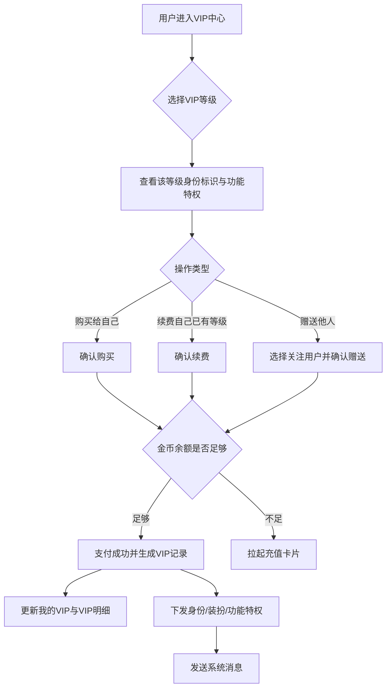
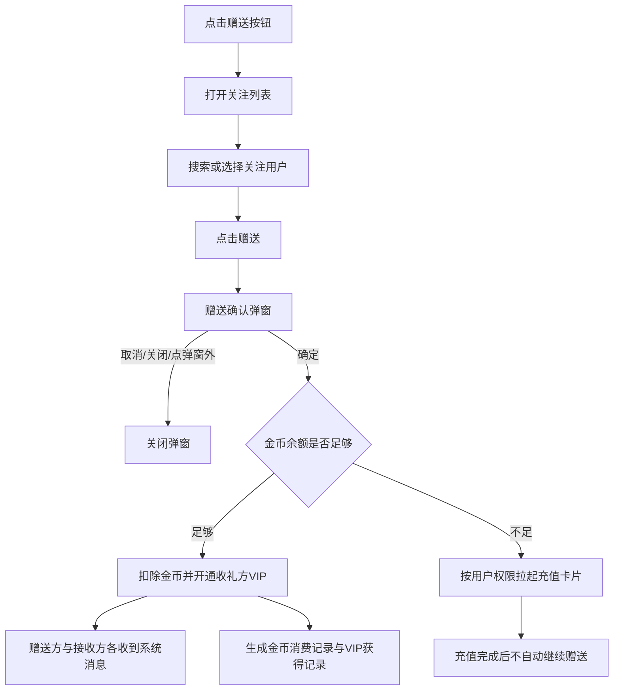
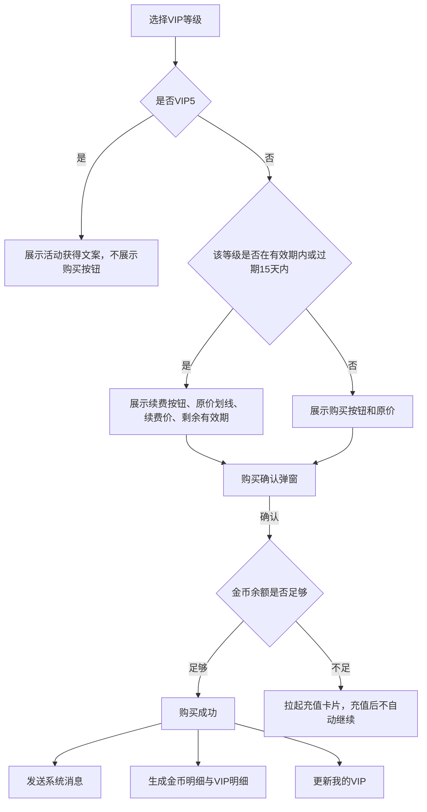
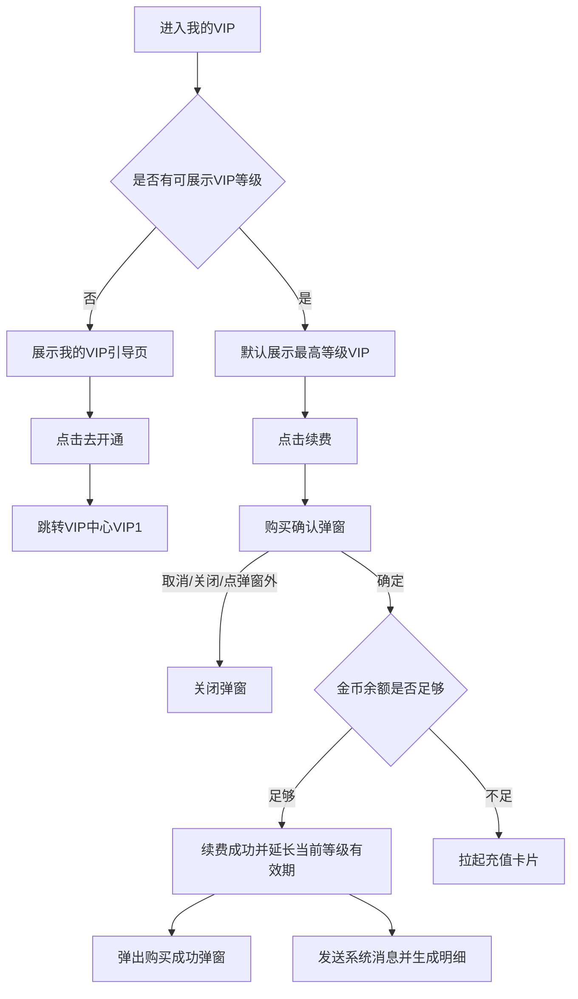
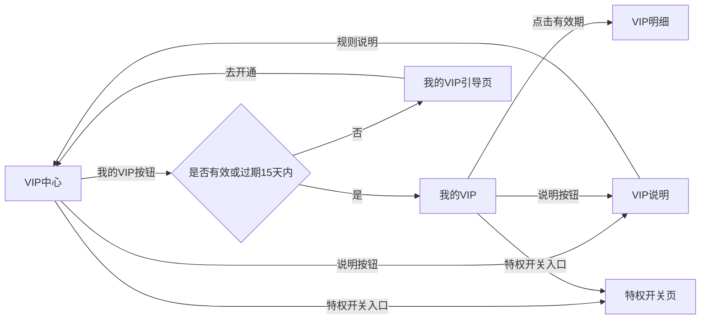
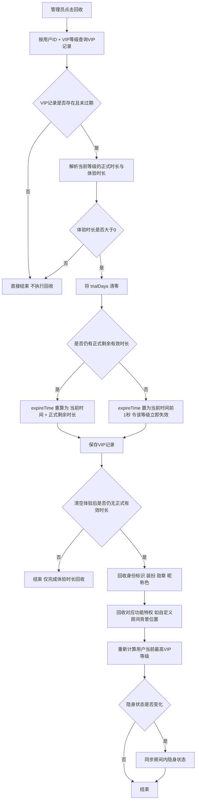

# VIP 完整需求文档（覆盖 6 个 Axure 页面）

> 生成时间：2026-06-13 11:39:06  
> 文档类型：客户端 VIP 体系 PRD / Axure 原型整理版  
> 覆盖范围：VIP中心、我的VIP、VIP明细、VIP说明、特权开关页、VIP说明总汇  
> 原型来源：Axure Cloud，访问凭证已脱敏为 `code=[REDACTED]`  
> 本文写法：先引用 Axure 原型事实，再按 PRD 结构补齐字段、交互、系统后台核心逻辑、边界情况、验收标准。

---

## 0. 文档范围与来源说明

### 0.1 本次纳入范围

| 序号 | Axure 页面 | 原型链接（已脱敏） | 本地原型截图 | 本地原文提取 |
|---:|---|---|---|---|
| 1 | VIP中心（新增） | `http://www.axurecloud.cn/ZLGA50/?code=[REDACTED]&id=ytjvda&g=15&p=vip中心（新增）&sc=3` | `vip-complete-prd-assets/vip_center_axure_full.png` | `vip-complete-prd-assets/vip_center_axure_text.txt` |
| 2 | 我的VIP（新增） | `http://www.axurecloud.cn/ZLGA50/?code=[REDACTED]&id=0dua33&g=15&p=我的vip（新增）&sc=3` | `vip-complete-prd-assets/my_vip_axure_full.png` | `vip-complete-prd-assets/my_vip_axure_text.txt` |
| 3 | VIP明细（新增） | `http://www.axurecloud.cn/ZLGA50/?code=[REDACTED]&id=fxv5wv&g=15&p=vip明细（新增）&sc=3` | `vip-complete-prd-assets/vip_detail_axure_full.png` | `vip-complete-prd-assets/vip_detail_axure_text.txt` |
| 4 | VIP说明（新增） | `http://www.axurecloud.cn/ZLGA50/?code=[REDACTED]&id=kib1do&g=15&p=vip说明（新增）&sc=3` | `vip-complete-prd-assets/vip_explain_axure_full.png` | `vip-complete-prd-assets/vip_explain_axure_text.txt` |
| 5 | 特权开关页（新增） | `http://www.axurecloud.cn/ZLGA50/?code=[REDACTED]&id=4pnik7&g=15&p=特权开关页（新增）&sc=3` | `vip-complete-prd-assets/vip_privilege_switch_axure_full.png` | `vip-complete-prd-assets/vip_privilege_switch_axure_text.txt` |
| 6 | VIP说明总汇（新增） | `http://www.axurecloud.cn/ZLGA50/?code=[REDACTED]&id=4mutgr&g=15&p=vip说明总汇（新增）&sc=3` | `vip-complete-prd-assets/vip_summary_axure_full.png` | `vip-complete-prd-assets/vip_summary_axure_text.txt` |

### 0.2 内容来源标识

| 标识 | 含义 | 使用方式 |
|---|---|---|
| **Axure原文要点** | 从 iframe 文本真实提取的原型说明 | 作为业务事实来源，保留原规则含义 |
| **原型图证据** | 从 Axure iframe 全画布截图生成 | 插在对应功能模块下，不集中堆图 |
| **PRD化补齐** | 按 PRD skill 补齐字段、状态、交互、后台逻辑、边界、验收 | 不是 Axure 逐字原文，是产品化整理 |
| **待确认项** | Axure 内部冲突、旧文案残留或实现口径不确定 | 不强行拍板，列入产品确认 |

### 0.3 关键约束

1. VIP 购买、续费、赠送仅支持金币类资产；Axure 文案中同时出现 `Gold coins` 与 `Diamonds`，本文统一称为 **金币**，但保留“币种命名待确认”。
2. VIP 一次购买/赠送默认 30 天；有效期按不同 VIP 等级独立计算。
3. 用户可以同时拥有多个不同等级 VIP。
4. 非装扮身份标识默认展示最高等级；装扮类权益进入背包，用户可自行佩戴；功能特权按当前拥有的最高 VIP 等级覆盖。
5. VIP5 不支持用户自行购买，仅通过活动或平台赠送获得。
6. VIP 过期后 15 天内仍处于续费优惠期；超过 15 天后恢复原价购买。
7. **每日登录返币权益硬规则：仅通过用户本人购买或续费获得的正式 VIP，才可获得每日登录返币权益；后台赠送、他人赠送、活动赠送、平台赠送、体验 VIP 均不触发每日登录返币权益。**

---

## 1. VIP 业务总览

### 1.1 业务定位

VIP 是平台面向高价值用户的身份、装扮与功能特权体系。它同时承担三类产品目标：

| 目标 | 说明 |
|---|---|
| 身份展示 | 通过标签、勋章、头像框、资料卡片、空间动效等公开场景展示用户尊贵身份 |
| 装扮消费 | 用户购买或获赠 VIP 后获得对应等级装扮，装扮进入背包并受 VIP 有效期约束 |
| 功能特权 | 解锁特权礼物、麦位表情包、房间在线列表突出显示、房间弹幕免费、防踢出、防禁止、防邀请、隐身访问等能力 |

### 1.2 用户主路径

### 1.3 VIP 状态模型

| 状态 | 判断条件 | 用户可见页面 | 购买/续费策略 | 特权状态 |
|---|---|---|---|---|
| 未开通过 VIP | 用户无任何 VIP 记录，或全部过期超过 15 天 | VIP中心、我的VIP引导页 | 原价购买 | 不拥有 VIP 特权 |
| 有效期内 | 当前等级 VIP 未过期 | VIP中心、我的VIP、VIP明细、特权开关页 | 当前等级可按续费价续费 | 可使用对应等级特权 |
| 过期后 15 天内 | 当前等级已过期，但仍在 15 天续费优惠期 | VIP中心、我的VIP | 当前等级可按续费价续费 | 已过期等级特权不可继续使用，除非另有体验 VIP 生效 |
| 过期超过 15 天 | 当前等级已过期且超过续费优惠期 | VIP中心、我的VIP引导页 | 恢复原价购买 | 不可使用该等级特权 |
| 多等级并存 | 同时拥有多个等级有效期或续费期 | 我的VIP按最高等级默认展示，可切换查看 | 各等级独立购买/续费 | 非装扮与功能特权默认按最高等级覆盖 |

### 1.4 VIP 等级价格与特权矩阵

> 来源：Axure「VIP说明总汇」截图 OCR。若最终运营配置与此表不同，以后台最终配置为准。

**功能描述：** 该图是 VIP 价格与等级特权矩阵，定义 VIP1 至 VIP5 的原价、续费价、可购买状态、身份标识权益和功能特权解锁等级。  
**关键交互：** 该图本身不是用户操作页，但它直接决定 VIP中心页的价格展示、购买/续费按钮状态、特权图标可获得/不可获得状态，以及特权开关页的锁定状态。

| VIP等级 | 原价（30天） | 续费价（30天） | 是否支持用户购买 | 已确认身份标识特权 | 已确认功能特权 |
|---|---:|---:|---|---|---|
| VIP1 | 400,000 金币 | 320,000 金币 | 支持 | 标签、勋章、头像框、座驾、聊天气泡、资料卡片、进场动效、声浪特效、主页特效、房间背景 | 特权礼物、麦位表情包、房间在线用户列表突出显示 |
| VIP2 | 1,000,000 金币 | 800,000 金币 | 支持 | 同 VIP1 | VIP1 功能 + 专属自定义房间背景位置 |
| VIP3 | 2,200,000 金币 | 1,760,000 金币 | 支持 | 同 VIP1 | VIP2 功能 + 房间弹幕免费 |
| VIP4 | 6,000,000 金币 | 4,800,000 金币 | 支持 | 同 VIP1 | VIP3 功能 + 防踢出、防禁止 |
| VIP5 | 不支持用户自己购买 | 不支持用户自己购买 | 不支持 | 同 VIP1 | VIP4 功能 + 防邀请、隐身访问 |

> 补充说明（按服务端现状先补口径）：`UserVipProperties` 已配置 VIP1-VIP7。本文正文客户端主链路继续按 Axure 的 VIP1-VIP5 书写；后台赠送与奖励资格章节按服务端已存在的 VIP6/VIP7 补充。

---

## 2. 全局业务规则

### 2.1 购买、续费、赠送规则

| 规则项 | 规则说明 | 来源 |
|---|---|---|
| 购买给自己 | 非续费期按原价购买；支付成功后开通对应等级 VIP | VIP中心、VIP说明、VIP说明总汇 |
| 续费给自己 | 在当前等级有效期内或过期 15 天内，可按续费价续费；续费成功在当前有效期基础上增加 30 天 | VIP中心、我的VIP、VIP说明、VIP说明总汇 |
| 赠送他人 | 只能按原价购买并赠送给关注用户；不享受续费价 | VIP中心、VIP说明、VIP说明总汇 |
| VIP5 | 用户不可自行购买，仅通过活动或运营赠送获得 | VIP中心、VIP说明总汇 |
| 支付资产 | 原型主视觉写 Gold coins；部分交互说明写 Diamonds。本文统一写金币，待产品确认最终命名 | VIP中心、VIP说明 |
| 支付失败 | 金币余额不足时拉起充值卡片；充值完成不自动继续购买或赠送流程 | VIP中心、我的VIP |
| 退款 | VIP 一旦购买成功，不支持退款 | VIP说明 |

### 2.2 有效期规则

| 场景 | 处理规则 |
|---|---|
| 用户无 VIP 时获得 VIP | 立即生效，按获得的 VIP 时间计算有效期 |
| 用户已有同等级 VIP 时再次获得 | 等同延长时间，在当前到期时间基础上增加对应天数 |
| 用户已有不同等级 VIP 时获得新等级 | 新等级直接生效，不同等级时间线独立计算 |
| 购买/赠送默认时长 | 默认 30 天 |
| VIP卡/体验卡 | 使用后按道具卡对应时长生效；明细记录以使用时间为获得时间 |
| 有效期边界 | Axure 示例：10月1日 13:00:00 购买，10月31日最后一刻失效；即按 30 个自然日最后一天最后一刻计算 |
| 续费优惠期 | 当前等级有效期内或过期后 15 天内 |

### 2.3 多 VIP 并存与权益覆盖规则

| 权益类型 | 覆盖规则 | 用户是否可更换 |
|---|---|---|
| 非装扮身份标识：标签、昵称/消息变色等 | 默认展示用户拥有的最高等级 VIP 标识 | 不可更换 |
| VIP勋章 | 有效期内自动点亮；多个 VIP 勋章按高等级优先展示；过期后消失 | 不可手动更换，只按点亮状态展示 |
| 装扮标识：头像框、聊天气泡、资料卡片、空间动效、房间背景、进场特效、座驾、声浪特效等 | 对应 VIP 等级装扮下发到背包；有效期跟随对应 VIP 等级 | 可在背包或我的VIP中佩戴 |
| 功能特权 | 用户可使用当前拥有的最高等级 VIP 功能范围 | 不需要手动切换 |

### 2.4 自动佩戴规则

| 场景 | 自动佩戴规则 |
|---|---|
| 用户当前不在任何 VIP 有效期内，开通成功 | 自动佩戴该 VIP 等级获得的所有装扮 |
| 用户当前已有有效 VIP，获得更低等级 VIP | 不自动替换当前装扮 |
| 用户当前已有有效 VIP，获得更高等级 VIP | 自动佩戴新的高等级所有 VIP 装扮 |
| 用户手动一键佩戴 | 仅在当前 VIP 有效期内可成功；过期时提示续费后继续佩戴 |

### 2.5 系统消息规则

| 场景 | 接收方 | 消息内容规则 |
|---|---|---|
| 自己购买/续费成功 | 购买方 | 欢迎成为对应 VIP 等级成员，展示拥有的 VIP 标识、装扮、专属礼物等特权，以及剩余有效期 |
| 赠送成功 | 赠送方 | 提示已成功赠送给收礼方，可提醒对方查看 |
| 赠送成功 | 接收方 | 提示某用户赠送了对应 VIP 等级，说明当前成为该 VIP 成员并展示剩余有效期 |
| VIP 剩余 3 天到期 | VIP 用户 | 团队通知：当前购买的 VIP 还剩 3 天到期，引导去续费 |

---

## 3. 页面一：VIP中心（新增）

### 3.1 页面定位

**Axure原文要点：** VIP中心是各 VIP 等级的特权说明和购买页，支持购买给自己，也支持赠送给平台其他用户，仅支持金币购买和赠送，不支持装扮折扣券和代金券。

**功能描述：** VIP中心承载 VIP 等级浏览、特权说明、购买、续费、赠送、我的VIP入口、VIP说明入口和特权开关入口。用户可通过等级菜单或勋章展示区切换不同等级，查看该等级身份标识、装扮、功能特权和价格。  
**关键交互：** 用户选择等级后，下方身份标识、功能特权、购买/续费/赠送按钮随等级刷新；点击特权图标弹出说明弹窗；点击赠送进入关注用户选择；点击购买/续费进入二次确认。

### 3.2 页面入口与落地规则

| 入口 | 默认落地 | 备注 |
|---|---|---|
| 普通入口未指定等级 | VIP1 菜单 | Axure 原文要求 |
| 入口明确指定等级 | 指定 VIP 等级菜单 | 用于特权引导弹窗、活动引导等场景 |
| 从我的VIP右滑进入 | VIP5 菜单 | Axure 原文要求 |
| VIP说明页“成为VIP”按钮 | 对应解锁等级菜单 | 例如 VIP4 专属槽位引导落地 VIP4 |

### 3.3 字段与数据来源

| 字段 | 说明 | 数据来源 / 计算方式 |
|---|---|---|
| VIP等级列表 | VIP1 至 VIP5，未来支持新增/删减等级 | VIP等级配置 |
| 当前选中等级 | 当前页面展示的 VIP 等级 | 页面默认落地规则或用户点击/滑动选择 |
| 等级勋章动态效果 | 当前等级居中放大彩色展示，左右相邻等级降低透明度 | VIP视觉资源配置 |
| 身份标识数量 | 如专属装扮（10/10） | 当前等级可获得身份/装扮配置汇总 |
| 功能特权数量 | 左侧为当前等级可使用数量，右侧为全部功能特权数量 | 当前等级功能特权配置与全部功能特权配置 |
| 原价 | 非续费期购买价、赠送价 | VIP价格配置 |
| 续费价 | 当前等级在续费期内展示的优惠价格 | VIP价格配置 + 用户该等级有效期状态 |
| 剩余有效期 | 当前等级有效剩余天数 | 用户当前等级 VIP 到期时间计算 |
| 赠送对象 | 关注列表中的用户 | 用户关注关系与用户资料 |
| 关注用户标签 | 国家、壕/魅等级、VIP标签 | 用户资料、等级资料、VIP有效状态 |

### 3.4 核心交互逻辑

| 编号 | 交互点 | 规则 |
|---:|---|---|
| 1 | 返回键 | 返回上一页 |
| 2 | 我的VIP按钮 | 当前在 VIP 有效期内或过期 15 天内，跳转我的VIP；否则跳转我的VIP引导页 |
| 3 | 说明按钮 | 跳转 VIP说明页 |
| 4 | VIP等级菜单 | 支持点击与左右滑动切换；选中菜单有状态区分；菜单支持后台配置增删等级 |
| 5 | 勋章展示区 | 展示当前等级动态勋章，左右展示相邻等级，按等级顺序滑动，不循环 |
| 6 | 专属身份展示区 | 展示该等级身份标识，点击进入特权说明弹窗 |
| 7 | 功能特权展示区 | 展示全部功能特权，区分当前等级可用/不可用状态，点击进入特权说明弹窗 |
| 8 | 赠送按钮 | 固定底部；展示原价赠送；点击拉起关注列表 |
| 9 | 购买/续费按钮 | 固定底部；根据当前等级是否处于续费期展示购买或续费状态 |
| 10 | VIP5 文案 | VIP5 不展示购买按钮和价格，仅展示“VIP5仅通过活动获得” |
| 11 | 特权开关入口 | 点击跳转特权开关页 |

### 3.5 特权说明弹窗规则（交互 6.1）

#### 对应原型

**功能描述：** 特权说明弹窗用于承接 VIP中心页“专属身份展示区”和“功能特权展示区”的图标点击结果，向用户展示单个特权的预览图、特权名称、说明文案，以及可继续切换查看的相邻特权。  
**关键交互：** 用户点击任一特权图标后打开弹窗；可通过顶部缩略项、右侧切换箭头、图片区交互在多个特权之间切换；可通过底部圆形关闭按钮关闭弹窗。

#### 前置条件

- 用户已进入 VIP中心页面。
- 页面当前已选中某一 VIP 等级。
- 当前等级页面中至少渲染了身份标识区或功能特权区。
- 用户点击了某一个特权图标。

#### 可见字段与界面元素

| 字段 / 元素 | 说明 | 数据来源 |
|---|---|---|
| 顶部缩略切换项 | 顶部一排 5 个小方形缩略项，用于切换不同特权内容 | 当前弹窗可切换特权集合 |
| 缩略项选中态 | 当前选中项描边更粗，其他项为未选中态 | 当前弹窗索引 |
| 预览图片区 | 大图区域，展示“预览图片/效果” | 特权预览素材 |
| 右侧切换箭头 | 预览区域右侧的 `>` 箭头，用于切换下一项 | 弹窗切换控件 |
| 预览动作图标 | 预览区右下角圆形图标，表示可查看/播放 | 特权素材交互控件 |
| 特权名称 | 预览图下方标题，展示当前特权名称 | 特权配置 |
| 特权说明文案 | 标题下多行说明文字 | 特权说明配置 |
| 关闭按钮 | 卡片下方独立圆形 `X` 按钮 | 弹窗关闭控件 |

#### 交互逻辑

1. 用户点击 VIP中心页面中的某个身份标识图标或功能特权图标。
2. 系统打开特权说明弹窗，默认落在用户刚刚点击的那一项。
3. 顶部缩略切换项中，当前项以加粗描边表现选中态。
4. 用户点击顶部任一缩略项时，弹窗切换到对应特权内容。
5. 用户点击预览区右侧箭头时，切换到下一项特权内容。
6. 若特权素材支持播放/查看，用户点击预览区或右下角圆形动作图标时，进入全屏预览或播放态。
7. 若文案内容过长，文案区支持上下滑动查看完整说明。
8. 用户点击卡片下方圆形 `X` 时，关闭弹窗并返回 VIP中心页面原位置。

#### 系统后台核心逻辑

1. 弹窗内容必须与当前点击的特权一一对应，不能出现标题、图片、说明错位。
2. 顶部缩略项的顺序必须与 VIP说明总汇中该页面弹窗内容配置顺序一致。
3. 当前 VIP 等级未解锁的功能特权也可展示弹窗，但应以“不可获得”态展示对应状态说明。
4. 装扮类特权若支持预览或播放，系统需返回预览素材地址及展示方式；不支持预览的特权不应展示伪按钮。
5. 弹窗切换不应关闭弹窗重开，而应在同一弹窗内刷新当前索引和内容。

#### 状态设计

| 状态 | 说明 |
|---|---|
| 选中，可获得 | 当前展示项为已解锁特权，顶部对应缩略项为选中态 |
| 选中，不可获得 | 当前展示项为未解锁特权，但允许查看说明 |
| 未选中，可获得 | 其他已解锁特权可切换 |
| 未选中，不可获得 | 其他未解锁特权可切换查看说明 |

#### 边界情况

| 场景 | 处理规则 |
|---|---|
| 只有 1 个特权素材 | 不展示右侧切换箭头，或箭头置灰不可点 |
| 特权素材有多张图 | 保持在同一特权弹窗内切换图片，不改变顶部特权索引 |
| 特权不支持预览 | 预览图区域可展示静态图，但不进入全屏播放态 |
| 缩略项数量超过当前视口 | 需要支持横向滚动或分页，否则用户无法定位后续项 |
| 文案为空 | 至少保留基础说明占位，不允许打开空白弹窗 |

### 3.6 关注列表与赠送对象选择（交互 8.1）

#### 对应原型

#### 功能说明

关注列表弹层用于承接 VIP中心页“赠送”按钮点击后的对象选择流程。用户可通过昵称/UID 搜索已关注用户，并对单个用户执行赠送操作。

#### 前置条件

- 用户当前位于 VIP中心页。
- 当前选中的 VIP 等级支持赠送路径。
- 用户点击了底部“赠送”按钮。

#### 可见字段与数据来源

| 字段 / 元素 | 说明 | 数据来源 |
|---|---|---|
| 面板标题 | `我的关注` | 固定文案 |
| 搜索图标 | 搜索框左侧放大镜图标 | UI资源 |
| 搜索输入框 | 占位文案 `昵称/UID` | 搜索框配置 |
| 清空按钮 | 搜索框右侧 `X` | 输入框状态 |
| 用户头像 | 列表左侧圆形头像位 | 用户资料 |
| 用户昵称 | 列表主标题 | 用户资料 |
| 国家标签 | 用户所属国家或地区标签 | 用户资料 |
| 等级标签 | 用户财富/魅力等级标签 | 用户等级资料 |
| VIP标签 | 若目标用户是 VIP 用户则展示，如示意图中存在 `VIP4` 表达 | 目标用户当前最高 VIP 等级 |
| 赠送按钮 | 每行右侧蓝色主操作按钮 | 行级操作 |

#### 交互逻辑

1. 用户点击 VIP中心底部“赠送”按钮，打开“我的关注”选择面板。
2. 面板顶部默认展示搜索框，支持按昵称或 UID 搜索关注用户。
3. 当输入框有内容时，右侧展示清空 `X`；点击后清空当前输入内容并保留焦点。
4. 列表每一项展示头像、用户昵称、国家、等级；如对方存在 VIP 身份，则额外展示 VIP 标签与等级。
5. 用户点击某一行右侧“赠送”按钮后，进入赠送确认弹窗 8.2。
6. 当搜索结果为空时，应展示空状态而不是空白面板。

#### 系统后台核心逻辑

1. 搜索范围应限定在“我关注的用户”集合中，不应返回陌生用户。
2. 搜索条件需同时支持昵称模糊匹配与 UID 精确或前缀匹配。
3. 列表中 VIP 标签应展示目标用户的当前最高有效 VIP 等级。
4. 用户列表状态、搜索结果与赠送操作必须在点击“赠送”时再次校验，防止目标用户资料变化导致下单对象错误。

#### 边界情况

| 场景 | 处理规则 |
|---|---|
| 搜索无结果 | 展示空状态文案与空列表占位 |
| 用户已被取消关注 | 列表刷新后不再展示该用户 |
| 用户头像/国家缺失 | 保留默认占位，不影响赠送 |
| 同一用户重复快速点击赠送 | 只允许进入一个确认弹窗实例 |

### 3.7 赠送确认弹窗（交互 8.2）

#### 对应原型

#### 功能说明

赠送确认弹窗用于在用户正式支付前，确认“赠送给他人”的 VIP 等级、时长和视觉标识，降低误赠风险。

#### 前置条件

- 用户已在关注列表中选中某一用户。
- 当前 VIP 等级已确定。
- 用户已点击该用户右侧“赠送”按钮。

#### 可见字段与数据来源

| 字段 / 元素 | 说明 | 数据来源 |
|---|---|---|
| 弹窗标题 | `赠送确认` | 固定文案 |
| 关闭按钮 | 右上角圆形 `X` | 弹窗控件 |
| VIP徽章图 | 中部大图，展示当前赠送的 VIP 视觉标识 | VIP视觉资源 |
| VIP规格文案 | 如 `VIP3*30天` | 当前选中VIP等级 + 固定30天时长 |
| 底部操作区 | 截图未完整展示，但 Axure正文要求存在确认/取消路径 | 弹窗操作配置 |

#### 交互逻辑

1. 用户在关注列表点击“赠送”后，打开赠送确认弹窗。
2. 弹窗顶部展示“赠送确认”，中部展示当前赠送 VIP 的徽章图与时长规格。
3. 用户点击右上角 `X` 时，关闭弹窗并返回关注列表。
4. 根据 Axure正文规则，用户点击确认后应继续做余额校验；余额足够则支付成功并赠送到账，余额不足则拉起充值卡片。
5. 用户点击取消、关闭按钮或弹窗外区域时，关闭弹窗且不产生支付。

#### 系统后台核心逻辑

1. 赠送确认弹窗必须绑定唯一的“赠送对象 + VIP等级 + 时长”组合，不能在弹窗打开后被后台异步切换成其他档位。
2. 支付前需再次校验：目标用户、当前赠送等级、原价金额、送礼资格。
3. 支付成功后必须同步处理：VIP到账、资产扣减、VIP明细、金币明细、赠送方系统消息、接收方系统消息。

#### 边界情况

| 场景 | 处理规则 |
|---|---|
| 目标用户在弹窗期间失效 | 点击确认时重新校验，失败则提示并关闭弹窗 |
| 用户关闭弹窗 | 不保留支付态 |
| 当前档位切换后旧弹窗仍在 | 旧弹窗确认时应按打开时锁定的档位校验 |

### 3.8 购买确认弹窗（交互 9.1）

#### 对应原型

#### 功能说明

购买确认弹窗用于在用户为自己购买或续费当前 VIP 等级前，确认即将支付的 VIP 规格，减少误购。

#### 前置条件

- 用户当前位于 VIP中心。
- 当前选中的 VIP 等级已确定。
- 用户点击了购买或续费按钮。

#### 可见字段与数据来源

| 字段 / 元素 | 说明 | 数据来源 |
|---|---|---|
| 弹窗标题 | `购买确认` | 固定文案 |
| 关闭按钮 | 右上角圆形 `X` | 弹窗控件 |
| VIP徽章图 | 中部大图，展示当前购买的 VIP 视觉标识 | VIP视觉资源 |
| VIP规格文案 | 如 `VIP3*30天` | 当前选中VIP等级 + 固定30天时长 |
| 底部操作区 | 截图未完整展示，但 Axure正文要求存在确认/取消路径 | 弹窗操作配置 |

#### 交互逻辑

1. 用户点击购买或续费按钮，打开购买确认弹窗。
2. 弹窗展示当前 VIP 等级对应的徽章图和规格文案。
3. 用户点击右上角 `X` 时，关闭弹窗并返回 VIP中心。
4. 根据 Axure正文规则，点击确认后进入余额校验；余额足够则购买成功并弹出购买成功弹窗，余额不足则拉起充值卡片。
5. 用户点击取消、关闭按钮或弹窗外区域时，不产生支付。

#### 系统后台核心逻辑

1. 购买确认弹窗应锁定当前 VIP 等级、当前价格类型（原价或续费价）和时长。
2. 支付前再次校验用户当前是否仍满足续费期条件，避免在弹窗停留期间用户状态变化导致价格错用。
3. 支付成功后同步写入：VIP权益、资产扣减、VIP明细、金币明细、系统消息、我的VIP状态刷新。

#### 边界情况

| 场景 | 处理规则 |
|---|---|
| 用户从续费期进入弹窗但确认时已过期超15天 | 按最终确认时状态重新计算价格或提示刷新页面 |
| 用户快速重复点击购买 | 仅允许创建一个有效支付请求 |
| 用户关闭弹窗 | 页面保持原选中档位和滚动位置 |

### 3.9 赠送流程

### 3.7 购买/续费流程

### 3.8 系统后台核心逻辑

1. 根据用户当前选中等级、该等级有效期、过期时间与当前时间，计算购买/续费状态。
2. 赠送场景必须固定使用原价，不可使用续费价。
3. 用户购买/续费/获赠后，系统按等级独立维护有效期，不同等级互不覆盖。
4. 续费成功时，应在当前等级既有到期时间基础上顺延 30 天；如果当前等级已过期但仍在 15 天优惠期内，应从产品确认的生效基准计算有效期，默认建议从支付成功时间起计算新的 30 天。
5. VIP5 仅允许活动或运营发放，不允许客户端自助购买。
6. 支付成功后必须同步完成：资产扣减、VIP权益写入、VIP获得记录、金币明细、系统消息、装扮下发、我的VIP刷新。
7. 支付确认动作需要防重复提交，避免重复扣款或重复生成 VIP 记录。
8. 关注列表实时搜索需按昵称/UID匹配，最大输入 20 字符。

### 3.9 边界情况

| 场景 | 处理规则 |
|---|---|
| 金币不足 | 拉起充值卡片，充值成功后不自动继续购买/赠送 |
| 目标用户取消关注或资料变化 | 赠送确认时重新校验目标用户是否可接收赠送 |
| 用户重复点击确定 | 系统只处理一次支付，重复请求返回当前订单结果 |
| 当前等级配置下架 | 已拥有用户不应丢失历史有效期；新购买入口不展示或不可购买 |
| 用户同时拥有高低等级 | 购买低等级成功后不应覆盖高等级身份展示和功能特权 |
| VIP5入口 | 不展示购买/续费价格，防止用户误以为可自助购买 |
| 币种命名不一致 | UI 与系统记录必须统一为最终确认币种，不得出现 Gold coins/Diamonds 混用 |

### 3.10 验收标准

- [ ] VIP中心可覆盖 VIP1 至 VIP5 的等级切换。
- [ ] 每个等级可正确展示身份标识、功能特权、可获得/不可获得状态。
- [ ] VIP5 不展示购买按钮和价格，仅展示活动获得说明。
- [ ] 购买、续费、赠送按钮在页面底部固定，不随页面上下滚动移动。
- [ ] 续费期内展示原价划线、续费价与剩余有效期。
- [ ] 赠送只能走原价，且必须从关注列表选择用户。
- [ ] 金币不足时拉起充值卡片，充值后不自动继续支付。
- [ ] 购买/赠送成功后 VIP明细与金币明细均能生成记录。
- [ ] 特权弹窗支持滑动、图标菜单切换、预览、文本滚动、关闭。

---

## 4. 页面二：我的VIP（新增）

### 4.1 页面定位

**Axure原文要点：** 我的VIP展示用户当前所有拥有的 VIP 权益。当前在该 VIP 等级有效期内，或当前 VIP 等级过期 15 天内的用户，需要展示该页面；否则进入我的VIP引导页。

**功能描述：** 我的VIP用于展示用户拥有的 VIP 等级、有效期、身份标识、装扮、功能特权和续费入口。用户拥有多个 VIP 等级时默认展示最高等级，可左右滑动或点击等级分页查看其他等级。无有效 VIP 且不在续费优惠期内时展示空状态引导页，引导去开通。  
**关键交互：** 用户点击有效期进入VIP明细；点击特权图标打开说明弹窗；点击一键装扮批量佩戴当前等级装扮；点击续费进入支付确认；空状态页点击“去开通”跳转VIP中心。

### 4.2 页面状态

| 页面状态 | 触发条件 | 页面表现 |
|---|---|---|
| 我的VIP正常页 | 用户存在至少一个等级处于有效期内，或过期 15 天内 | 展示等级分页、用户卡、标识、装扮、功能特权、续费按钮 |
| 我的VIP空状态页 | 用户无有效 VIP 且不在任何等级过期 15 天内 | 展示顶部“VIP中心 / 我的VIP”双Tab、空状态文案、缺省图、去开通按钮 |
| 多等级状态 | 用户多个等级满足展示条件 | 默认展示最高等级，支持切换查看 |
| 正式 + 体验并存 | 同等级既有正式 VIP 又有体验 VIP | 有效期优先展示正式 VIP；正式过期后展示体验 VIP 生效状态 |

### 4.3 空状态页面结构

| 区块 | 说明 | 交互 |
|---|---|---|
| 返回按钮 | 左上角返回箭头 | 点击后返回上一页 |
| 顶部Tab | `VIP中心` 未选中，`我的VIP` 选中 | 点击 `VIP中心` 跳转 VIP中心；点击 `我的VIP` 留在当前页 |
| 帮助按钮 | 顶部右侧问号图标 | 点击后进入 VIP说明 / 帮助说明页面 |
| 空状态主文案 | `很遗憾`、`你尚未开通VIP`、`无法享受VIP权益` | 纯展示文案 |
| 缺省图 | 未开通 VIP 的空状态占位图 | 纯展示，用于承接空状态视觉 |
| 去开通按钮 | 页面唯一主操作按钮 | 点击后跳转 VIP中心，默认落地 VIP1 菜单 |

### 4.4 字段与数据来源

| 字段 | 说明 | 数据来源 / 计算方式 |
|---|---|---|
| 用户头像 | 展示用户头像并佩戴当前展示等级头像框 | 用户资料 + VIP装扮佩戴状态 |
| 用户昵称 | 超长省略 | 用户资料 |
| 用户ID | 展示靓号颜色与复制按钮 | 用户资料、靓号配置 |
| VIP标签 | 未过期才显示，已过期不显示 | 当前展示等级有效状态 |
| 壕等级标签 | 等级为 0 不显示 | 用户财富等级 |
| VIP等级勋章 | 有效期内彩色动态展示，过期灰色动态展示 | 当前展示等级与有效期状态 |
| VIP有效期 | 正式/体验/过期优惠期文案 | 当前展示等级的正式、体验、过期时间计算 |
| 我的VIP标识 | 标签、昵称变色、消息变色、礼物跑道等非装扮标识 | 当前展示等级身份配置 |
| 我的VIP装扮 | 头像框、座驾、聊天气泡、资料卡片、进场动效、声浪特效等 | 当前展示等级装扮配置与用户获得状态 |
| 我的VIP特权 | 当前等级拥有的功能特权 | 当前展示等级功能特权配置 |
| 续费价格 | 展示续费价和划线原价 | 当前等级价格配置 + 续费期状态 |
| 续费剩余有效期 | 有效期内显示剩余有效期，过期后显示续费优惠剩余期 | 当前展示等级到期时间与15天优惠期计算 |

### 4.5 核心交互逻辑

| 编号 | 交互点 | 规则 |
|---:|---|---|
| 1 | 返回键 | 返回上一页 |
| 2 | VIP中心按钮 | 跳转 VIP中心，落地 VIP1 菜单 |
| 3 | 说明按钮 | 跳转 VIP说明页 |
| 4 | 等级分页菜单 | 仅当用户当前在 VIP 使用期内或失效后 15 天内出现；支持点击与左右滑动切换 |
| 5 | 用户基本信息 | 展示头像、昵称、ID、VIP标签、壕等级、等级勋章、有效期 |
| 6 | VIP有效期 | 点击跳转 VIP明细页 |
| 7 | 我的VIP标识 | 点击图标打开特权展示弹窗 |
| 8 | 我的VIP装扮 | 点击图标打开特权展示弹窗；点击一键佩戴执行批量佩戴 |
| 9 | 我的VIP特权 | 点击图标打开特权展示弹窗 |
| 10 | 续费按钮 | 固定底部；点击进入购买确认弹窗 |
| 11 | 空状态页去开通 | 跳转 VIP中心，落地 VIP1 菜单 |
| 12 | 特权开关入口 | 点击跳转特权开关页 |

### 4.6 特权展示弹窗

**功能描述：** 特权展示弹窗用于在“我的VIP”页中展示某项 VIP 特权或装扮的预览效果、特权名称、说明文案，并承接查看详情、去设置、佩戴等操作。该弹窗属于“特权说明 + 预览 + 操作承接”中间层，不直接替代特权开关页或装扮设置页。  
**关键交互：** 用户点击“我的VIP标识”“我的VIP装扮”“我的VIP特权”中的某一项后，弹出特权展示弹窗；用户可查看预览效果、播放动态演示、点击查看详情、去设置，或直接点击佩戴。

#### 弹窗结构

| 区块 | 说明 | 交互 |
|---|---|---|
| 预览图片区 | 展示特权静态封面图、效果图或动效封面 | 点击播放按钮可查看动态效果；右箭头可切换预览内容或查看下一张效果图 |
| 特权名称 | 展示当前特权名称 | 纯展示 |
| 特权说明文案 | 展示特权用途、使用说明、适用场景、触发条件 | 支持多行文案 |
| 佩戴按钮 | 当前弹窗主操作按钮 | 点击后直接佩戴或启用该特权 |

#### 字段与数据来源

| 字段 | 说明 | 数据来源 / 计算方式 |
|---|---|---|
| 预览图片/效果 | 当前特权的静态图、封面图或效果图 | 特权资源配置 |
| 播放按钮 | 预览图右下角播放图标 | 当前特权是否存在视频/动效资源 |
| 切换箭头 | 预览区右侧切换按钮 | 当前特权是否有多张预览图或多种效果展示 |
| 特权名称 | 当前特权名称 | VIP特权配置 |
| 特权说明文案 | 对当前特权的说明文案 | VIP特权说明配置 |
| 佩戴按钮 | 当前特权启用/佩戴入口 | 用户是否已获得该特权 + 当前特权类型 |

#### 适用场景

| 场景 | 说明 |
|---|---|
| 装扮类特权 | 头像框、聊天气泡、资料卡片、进场动效、座驾、声浪特效等 |
| 功能类特权 | 需要先查看说明，再决定是否去设置或启用的特权 |
| 新获得权益提醒 | 用户获得某项权益后，通过弹窗展示效果并引导使用 |
| 我的VIP详情查看 | 用户在我的VIP页内点击某个特权图标后查看具体内容 |

#### 交互逻辑补充

1. 用户在“我的VIP标识”“我的VIP装扮”“我的VIP特权”区点击某个图标后，打开特权展示弹窗。
2. 弹窗默认展示该特权的预览效果图、特权名称和说明文案。
3. 若该特权存在动态演示资源，则显示播放按钮；点击后播放动效或视频预览。
4. 若该特权存在多种预览素材，则展示右侧切换箭头，支持切换查看。
7. 点击“佩戴”后，系统校验用户是否已获得该特权、当前特权是否允许佩戴；校验通过则直接佩戴并提示成功。
8. 若当前特权已在使用中，按钮文案可根据最终产品态改为“已佩戴”或置灰禁用；当前原型仅体现“佩戴”主态。

### 4.7 有效期展示规则

| 当前条件 | 有效期展示 |
|---|---|
| 仅正式 VIP 未过期 | 展示正式 VIP 有效天数和过期时间 |
| 仅体验 VIP 未过期 | 展示体验 VIP 有效天数和过期时间 |
| 正式 + 体验并存 | 展示正式 VIP 有效天数和过期时间 |
| 正式 VIP 过期，体验 VIP 仍有效 | 不显示正式 VIP 已过期文案，切换为体验 VIP 生效状态 |
| VIP 已过期但仍在 15 天续费期 | 展示“已到期，X 天之后恢复原价购买” |

### 4.8 续费流程

### 4.9 系统后台核心逻辑

#### 特权展示弹窗判定规则

1. 特权展示弹窗只在用户点击具体特权图标、装扮图标或身份标识图标后打开，不自动覆盖“我的VIP”主页。
2. 弹窗展示内容必须与当前点击的特权对象一致，不允许出现“点击头像框却弹出聊天气泡说明”的错配。
3. 若当前特权存在可直接佩戴能力，则展示“佩戴”按钮；若当前特权需要先配置后生效，则展示“去设置”按钮；两者可以并存。
4. 若当前特权仅支持说明查看、不支持直接佩戴，则“佩戴”按钮应隐藏或置灰，最终以产品状态规则为准。
5. 特权展示弹窗中的资源图、说明文案、设置入口、佩戴能力均应来自同一个特权配置对象，防止图文口径不一致。

#### 空状态页判定规则

1. 当用户不存在任何有效 VIP，且也不处于任何等级的过期 15 天续费优惠期内时，进入“我的VIP”应展示空状态页。
2. 空状态页不展示等级分页、VIP用户卡、装扮区、特权区、续费按钮。
3. 空状态页保留顶部 Tab 结构，确保用户仍可切换到 VIP中心 继续浏览或开通。
4. 用户在空状态页点击“去开通”后，跳转 VIP中心 默认落地 VIP1 菜单。
5. 用户完成开通并返回后，页面应从空状态页切换为我的VIP正常页。

1. 我的VIP展示范围不能只看当前是否有效，还要包含“该等级过期后 15 天内”的续费优惠状态。
2. 用户多个等级并存时，默认展示最高等级；切换后，页面所有信息与当前展示等级保持一致。
3. 正式 VIP 与体验 VIP 并存时，展示优先级为正式 VIP；正式 VIP 过期后，体验 VIP 才成为展示与权益生效来源。
4. 一键佩戴需要判断当前展示等级是否仍在有效期内；过期不可佩戴。
5. 续费成功必须延长当前展示等级有效期，不得误续到最高等级或其他等级。
6. 点击有效期进入 VIP明细页，明细页需要能追溯当前等级所有获得记录。
7. 剩余 3 天到期通知只应针对用户购买的 VIP 触发；他人赠送、平台赠送、体验 VIP 是否触发需产品确认。

### 4.10 边界情况

| 场景 | 处理规则 |
|---|---|
| 用户点击未获得的特权 | 可展示说明，但“佩戴”按钮应禁用或提示未获得 |
| 特权只有说明没有动态资源 | 不展示播放按钮 |
| 特权有说明但没有设置入口 | 不展示“去设置”按钮 |
| 特权已在使用中 | “佩戴”按钮可展示为已佩戴态或禁用态 |

| 场景 | 处理规则 |
|---|---|
| 用户从空状态页完成开通返回 | 重新拉取 VIP 状态；若已开通则切换为我的VIP正常页 |
| 用户存在过期 15 天内的等级 | 不展示空状态页，仍进入我的VIP正常页并展示续费入口 |
| 用户仅有后台赠送但已全部过期，且不在任何等级续费优惠期内 | 展示空状态页 |

| 场景 | 处理规则 |
|---|---|
| 多等级中只有低等级过期 15 天内 | 我的VIP仍可展示该低等级分页，但默认页仍取当前满足展示条件的最高等级 |
| VIP过期但装扮仍在佩戴 | 页面可展示过期状态；系统应按装扮有效期决定是否继续展示，默认过期后不可继续生效 |
| 一键佩戴时网络失败 | 保留原佩戴状态，提示操作失败可重试 |
| 复制用户ID | 点击复制按钮提示“复制成功” |
| 已过期且超过15天 | 进入我的VIP引导页，不展示过期等级分页 |
| 正式与体验时间切换 | 正式过期后应自动刷新卡片到体验 VIP 状态，避免显示“已过期”误导用户 |

### 4.11 验收标准

- [ ] 点击我的VIP标识、装扮、特权图标可打开特权展示弹窗。
- [ ] 弹窗可展示预览图、特权名称、特权说明文案。
- [ ] 存在动态资源的特权可显示播放按钮并进入预览。
- [ ] 需要设置的特权可显示“去设置”按钮并跳转对应页面。
- [ ] 可直接启用的特权可通过“佩戴”按钮完成佩戴。

- [ ] 我的VIP空状态页可正确展示未开通文案、缺省图和去开通按钮。
- [ ] 空状态页点击“去开通”后跳转 VIP中心，默认落地 VIP1 菜单。
- [ ] 用户开通成功返回后，空状态页可自动切换为我的VIP正常页。

- [ ] 有效期内和过期 15 天内用户进入我的VIP正常页。
- [ ] 非有效且非续费优惠期用户进入我的VIP引导页。
- [ ] 多 VIP 等级用户默认展示最高等级，切换后信息同步变更。
- [ ] 正式 + 体验并存时优先展示正式 VIP；正式过期后体验 VIP 生效展示。
- [ ] 一键佩戴在有效期内成功，过期时提示续费后可继续佩戴。
- [ ] 点击有效期跳转 VIP明细页。
- [ ] 续费确认、成功、余额不足逻辑与VIP中心一致。

---

## 5. 页面三：VIP明细（新增）

### 5.1 页面定位

**Axure原文要点：** VIP明细页用于展示用户获得 VIP 的记录。记录来源包括原价购买、续费购买、他人赠送、平台赠送正式VIP、活动等。

**功能描述：** VIP明细是用户查看所有 VIP 获得记录的明细页，按获得时间倒序展示每条记录的 VIP 等级、来源、获得时间和生效天数。  
**关键交互：** 用户从我的VIP有效期区域进入明细页；明细页主要为浏览型页面，返回键返回上一页。

### 5.2 字段与数据来源

| 字段 | 说明 | 数据来源 / 计算方式 |
|---|---|---|
| VIP等级 | 记录获得的 VIP 等级 | VIP获得记录 |
| 来源 | 购买、续费、他人赠送、活动、平台赠送、体验卡/正式卡等 | 获得渠道 |
| 获得时间 | VIP获得或道具卡使用时间，精确到分钟 | 支付成功时间、赠送到账时间、运营发放时间、道具使用时间 |
| 生效天数 | 本次记录增加的 VIP 天数 | 商品配置、活动配置、运营发放配置、道具卡时长 |
| VIP类型 | 正式 VIP 或体验 VIP | 获得记录类型 |
| 排序时间 | 用于由近到远倒序排列 | 获得时间 |

### 5.3 生效时间规则

| 场景 | 生效逻辑 |
|---|---|
| 用户已有相同等级 VIP | 延长该等级当前有效期 |
| 用户已有不同等级 VIP | 新等级直接生效，与其他等级独立计算 |
| 用户没有 VIP | 直接生效，按获得时间计算 |
| 使用体验卡/VIP卡 | 获得时间以卡使用时间为准 |
| 平台赠送 | 以运营发放成功时间为获得时间 |

### 5.4 系统后台核心逻辑

1. 每一笔 VIP 获得行为都必须生成一条 VIP明细记录。
2. 明细记录应与资产流水、支付记录、赠送记录或运营发放记录可追溯对应。
3. 排序按获得时间倒序；同一分钟多条记录时，建议按记录生成顺序倒序作为兜底。
4. 生效天数展示必须来自真实获得记录，不应用当前剩余天数替代。
5. VIP等级展示必须与最终配置一致；Axure 示例中出现 VIP6，但当前等级总汇只展示 VIP1-VIP5，需产品确认是否为旧示例文案。

### 5.5 边界情况

| 场景 | 处理规则 |
|---|---|
| 用户暂无记录 | 展示空状态，引导去 VIP中心 |
| 记录来源未知 | 展示“其他”或“平台发放”，并保留内部来源用于客服排查 |
| 活动赠送多个等级 | 每个等级分别生成记录 |
| 同一等级多次续费 | 每次续费独立生成记录，生效天数分别展示 |
| VIP等级配置后续变更 | 历史记录展示当时获得的等级名称和天数，不因新配置覆盖历史 |

### 5.6 验收标准

- [ ] VIP获得记录按时间倒序展示。
- [ ] 每条记录包含等级、来源、获得时间、生效天数。
- [ ] 购买、续费、赠送、平台赠送、活动、体验卡均可生成明细。
- [ ] 获得时间精确到分钟。
- [ ] 历史记录不因等级配置调整而被错误改写。

---

## 6. 页面四：VIP说明（新增）

### 6.1 页面定位

**Axure原文要点：** VIP说明页展示 VIP 的详情，包括什么是 VIP、如何开通/续费/赠送、如何更换 VIP、如何使用 VIP 特权和注意事项。

**功能描述：** VIP说明是面向用户的帮助说明页，解释 VIP 购买、续费、赠送、切换、权益使用和不可退款等关键规则，降低用户对 VIP 多等级并存和续费优惠期的理解成本。  
**关键交互：** 页面以阅读为主，用户从 VIP中心或我的VIP点击说明按钮进入；返回键返回上一页。

### 6.2 内容结构

| 模块 | 内容要点 |
|---|---|
| 什么是VIP | VIP是平台尊贵用户象征，拥有装扮与特权功能，等级越高特权越高级 |
| 如何开通VIP | 在 VIP中心选择等级，点击购买并支付成功 |
| 如何续费VIP | 在 VIP中心或我的VIP点击续费，续费成功后增加当前等级 30 天有效期 |
| 续费期定义 | 当前等级有效期内或失效后 15 天内 |
| 如何赠送VIP | 在 VIP中心点击赠送，选择对象并支付成功 |
| 支付限制 | 购买/续费/赠送只能使用金币，不能用其他代币、折扣券、代金券 |
| 如何更换VIP | 可同时拥有多个不同等级；有效期独立；最高等级身份标识默认展示；装扮进背包自由佩戴 |
| 如何使用特权 | 未成为 VIP 时在 VIP中心查看说明；成为 VIP 后在我的VIP查看使用方式 |
| 注意事项 | VIP购买成功不支持退款；VIP活动版权归平台，与苹果公司无关 |

### 6.3 字段与数据来源

| 字段 | 说明 | 数据来源 / 计算方式 |
|---|---|---|
| 说明标题 | 如“什么是VIP”“如何开通/续费/赠送VIP” | 运营配置或客户端静态文案 |
| 说明正文 | 用户可读的规则说明 | VIP业务规则整理 |
| 入口跳转 | 从 VIP中心、我的VIP说明按钮进入 | 页面路由配置 |
| 币种名称 | 文案中的金币名称 | 最终产品币种命名 |
| 苹果免责说明 | 与苹果公司无关 | 合规固定文案 |

### 6.4 系统后台核心逻辑

1. VIP说明页文案必须与 VIP中心、我的VIP、VIP说明总汇的真实规则保持一致。
2. 续费期、支付方式、赠送价格、退款规则属于高风险文案，禁止多个页面口径不一致。
3. 如果后续 VIP等级、价格、特权解锁发生变化，VIP说明页需要同步更新，避免用户投诉。
4. 文案应支持多语言配置；当前 PRD 只整理中文业务规则。

### 6.5 边界情况

| 场景 | 处理规则 |
|---|---|
| 用户从不同页面进入说明页 | 说明内容一致，返回上一页 |
| 价格或等级调整 | 如果说明页写死价格，需要跟随配置同步；建议说明页不直接写具体价格，只引导去VIP中心查看实时价格 |
| 币种名称调整 | VIP说明、确认弹窗、明细、系统消息需统一替换 |
| 苹果合规文案缺失 | iOS端上线前必须补齐 |

### 6.6 验收标准

- [ ] 说明页覆盖 VIP定义、购买、续费、赠送、更换、使用、注意事项。
- [ ] 续费期定义与 VIP中心、我的VIP一致。
- [ ] 支付资产名称在全页面一致。
- [ ] 退款规则明确为购买成功不支持退款。
- [ ] 文案没有与 VIP说明总汇冲突的旧规则残留。

---

## 7. 页面五：特权开关页（新增）

### 7.1 页面定位

**Axure原文要点：** 特权开关页目前包含拒绝邀请与隐身访问两个开关。所有用户都展示开关，但未达到解锁等级时带锁标识且不可开启。两项特权均要求 VIP5 及以上。

**功能描述：** 特权开关页用于承接需要用户主动控制的 VIP 功能特权。当前包含“拒绝邀请”和“隐身访问”。VIP5 及以上用户可开启/关闭；未达到等级用户只能看到锁定状态，不可开启。  
**关键交互：** 用户点击开关时，系统先判断是否满足 VIP5 及以上；满足则切换状态并提示成功，不满足则无交互或保持锁定。

### 7.2 字段与数据来源

| 字段 | 说明 | 数据来源 / 计算方式 |
|---|---|---|
| 开关名称 | 拒绝邀请、隐身访问 | VIP功能特权配置 |
| 开关说明 | 对应功能开启后的效果说明 | 功能文案配置 |
| 解锁等级 | 当前两项均为 VIP5 | VIP等级特权配置 |
| 用户当前最高VIP等级 | 用于判断是否可开启 | 用户当前有效 VIP 等级，按最高等级计算 |
| 开关状态 | 开启/关闭/锁定 | 用户特权设置记录 + 当前等级判断 |
| 锁定标识 | 未达到解锁等级时展示 | UI资源配置 |
| 操作提示 | 开启成功、关闭成功等提示 | 文案配置 |

### 7.3 拒绝邀请开关

| 状态 | 页面表现 | 点击规则 | 业务效果 |
|---|---|---|---|
| 开启 | 开关打开 | 点击后关闭，提示“关闭成功，其他用户可以给你发送房间邀请消息了” | 其他用户无法给该用户发送房间邀请私聊消息 |
| 关闭 | 开关关闭 | VIP5及以上点击后开启，提示“开启成功，其他用户无法给你发送房间邀请消息了” | 其他用户可正常发送房间邀请 |
| 锁定 | 开关带 VIP5 标识与锁 | 非VIP5及以上点击无交互 | 无法开启该能力 |

### 7.4 隐身访问开关

| 状态 | 页面表现 | 点击规则 | 业务效果 |
|---|---|---|---|
| 开启 | 开关打开 | 点击后关闭，提示“关闭成功，现在进入房间将显示您的真实身份” | 进入房间时禁止播放进场动效和座驾动效，公屏显示“有隐身用户进来了”，在线列表不显示 |
| 关闭 | 开关关闭 | VIP5及以上点击后开启，提示“开启成功，进入房间将隐藏您的真实身份” | 进入房间正常展示真实信息 |
| 锁定 | 开关带 VIP5 标识与锁 | 非VIP5及以上点击无交互 | 无法开启该能力 |

### 7.5 隐身失效规则

| 场景 | 处理规则 |
|---|---|
| 用户进入房间且未互动 | 隐身生效，不播放进场动效和座驾动效，公屏展示隐身用户 |
| 用户赠送礼物 | 隐身失效，在线列表需要展示真实身份 |
| 用户发送公屏消息 | 隐身失效，在线列表需要展示真实身份 |
| 用户上麦 | 隐身失效，在线列表需要展示真实身份 |
| 用户已在房间在线列表中 | 开启隐身后，下次进入房间不展示；若原型所述“若之前已经存在则不展示在线”，需要系统刷新在线列表 |

### 7.6 系统后台核心逻辑

1. 特权开关页入口可以对所有用户展示，但开启操作必须校验当前有效 VIP 等级是否达到 VIP5。
2. 用户 VIP5 过期后，已开启的拒绝邀请和隐身访问应自动失效或置为不可用状态；建议保留用户历史选择，但运行时按当前等级校验。
3. 拒绝邀请开关需要在“邀请好友进房间”链路中实时校验。
4. 隐身访问需要在进入房间、在线列表、公屏进场消息、进场动效、座驾动效等多个房间模块联动。
5. 隐身状态发生失效行为后，需要及时刷新房间在线列表和用户展示状态。
6. 开关操作应有防重复提交，避免快速点击导致状态反复错乱。

### 7.7 边界情况

| 场景 | 处理规则 |
|---|---|
| 非VIP5用户点击锁定开关 | 无任何交互，或可按产品确认补充 VIP引导弹窗 |
| VIP5刚过期但开关仍开 | 功能实时失效；页面展示锁定或关闭状态 |
| 网络失败 | 开关视觉状态回滚，提示操作失败 |
| 多端同时修改 | 以后提交成功的状态为准，进入页面时拉取最新状态 |
| 隐身访问中产生互动 | 隐身即时失效，房间内真实身份展示恢复 |
| 拒绝邀请开启时对方邀请 | 邀请方收到“对方开启了拒绝邀请功能，无法邀请”类提示 |

### 7.8 验收标准

- [ ] 所有用户可看到两个开关，未达等级显示锁定标识。
- [ ] VIP5及以上可开启/关闭拒绝邀请和隐身访问。
- [ ] 非VIP5及以上用户无法开启。
- [ ] 开启拒绝邀请后，其他用户无法发送房间邀请私聊消息。
- [ ] 开启隐身访问后，进入房间不展示真实进场身份。
- [ ] 送礼、发公屏、上麦等互动会让隐身失效。
- [ ] VIP5过期后特权开关能力不再生效。

---

## 8. 页面六：VIP说明总汇（新增）

### 8.1 页面定位

**Axure原文要点：** VIP说明总汇定义 VIP 的来源、有效期、切换规则、身份标识特权、功能特权、弹窗说明内容、VIP引导弹窗触发场景，以及各等级价格与特权明细。

**功能描述：** VIP说明总汇不是单一用户操作页，而是 VIP 体系的规则总表。它为 VIP中心、我的VIP、特权弹窗、特权开关页、房间内特权校验、背包装扮佩戴等模块提供统一规则来源。  
**关键交互：** 该页本身无明确用户点击操作，但其中定义的弹窗文案、按钮文案和跳转逻辑会被其他页面调用。

### 8.2 VIP来源规则

| 来源 | 规则 |
|---|---|
| 用户自己购买 | 非 VIP 或当前等级过期超过 15 天时，可原价购买 |
| 用户自己续费 | 当前等级有效期内或过期后 15 天内，可用续费价格续费；即使当前 VIP 是他人赠送，也可按续费价续费 |
| 他人赠送 | 赠送只能支付原价，无续费优惠 |
| 官方赠送 | 由运营后台添加 VIP |
| 活动获得 | VIP5 等不可自购等级可通过活动获得 |
| VIP卡/体验卡 | 使用道具后按卡配置增加对应时长 |

### 8.3 身份标识特权清单

| 特权 | 获得范围 | 说明 | 预览/佩戴规则 |
|---|---|---|---|
| 标签 | 所有VIP等级 | 不同等级样式不同，展示 VIP 等级，排序在标签列表最前 | 不展示佩戴按钮，默认最高等级 |
| 头像框 | 所有VIP等级 | 不同等级样式不同，等级越高越精致，需动态效果 | 可全屏预览，可佩戴 |
| 聊天气泡 | 所有VIP等级 | 私聊时展示尊贵身份，不同等级样式不同 | 可全屏预览，可佩戴 |
| 资料卡片 | 所有VIP等级 | 用户资料卡展示尊贵身份，需要动态效果 | 可全屏预览，可佩戴 |
| 勋章 | 所有VIP等级 | 勋章墙、个人空间、资料卡片展示；过期消失 | 可全屏预览；查看按钮跳转勋章墙荣誉菜单 |
| 空间动效 | 所有VIP等级 | 个人空间展示动态身份 | 可全屏预览，可佩戴 |
| 房间背景 | 所有VIP等级 | 派对房间展示，需展示 VIP 等级和动态效果 | 可全屏预览，可佩戴 |
| 进场特效 | 所有VIP等级 | 每次进入房间展示尊贵身份 | 可全屏预览，可佩戴 |
| 座驾 | 所有VIP等级 | 高等级更精致；VIP5及以上座驾需要展示用户头像和昵称 | 可全屏预览，可佩戴 |
| 声浪特效 | 所有VIP等级 | 麦上说话时展示声浪样式，背包和商店新增声浪类型 | 可全屏预览，可佩戴 |

### 8.4 功能特权清单

| 特权 | 解锁等级 | 规则说明 | 关联模块 |
|---|---|---|---|
| 特权礼物 | VIP1及以上 | 特权礼物盘展示 VIP 专属礼物；高等级可赠送低等级礼物，低等级不可赠送高等级礼物 | 礼物弹窗页 |
| 麦位表情包 | VIP1及以上 | 所有 VIP 共用一套 8 个 VIP 表情包，不区分等级 | 房间表情弹窗 |
| 房间在线列表突出显示 | VIP1及以上 | 在线用户列表展示 VIP 背景并优先展示；多等级展示最高等级样式 | 在线用户列表 |
| 专属自定义房间背景位置 | VIP2及以上 | 可免费使用 2 个 VIP 专属自定义房间背景槽位 | 房间背景-自定义背景 |
| 房间弹幕免费 | VIP3及以上 | VIP3及以上免费发送房间弹幕；普通用户付费，原型写 1000 金币/条 | 公屏输入消息弹窗、金币明细 |
| 防踢出 | VIP4及以上 | 房主/管理员无法踢出 VIP4及以上用户，展示对应提示 | 用户资料卡片 |
| 防禁止 | VIP4及以上 | 房主/管理员无法禁麦、禁公屏、踢下座位 | 用户资料卡片 |
| 防邀请 | VIP5及以上 | 其他用户无法邀请开启该功能的用户进入房间 | 设置页、邀请好友进房间卡片 |
| 隐身访问 | VIP5及以上 | 进入房间隐藏真实身份，互动后隐身失效 | 设置页、房间在线列表、公屏 |

### 8.5 VIP引导弹窗规则

| 场景 | 弹窗文案 | 按钮文案 | 跳转规则 |
|---|---|---|---|
| 用户选中特权礼物并点击赠送，但不满足 VIP 条件 | 只有尊贵的 VIP1 及以上等级的用户，才可以赠送该礼物 | 成为VIP | 跳转 VIP中心，落地 VIP1，不退出房间 |
| 用户点击 VIP 麦位表情包但不满足条件 | 只有尊贵的 VIP1 及以上等级的用户，才可以使用这些表情 | 成为VIP | 跳转 VIP中心，落地 VIP1，不退出房间 |
| 房间内点击 VIP 自定义房间槽位开通按钮 | 这是尊贵的 VIP4及以上等级用户的专属位置，购买VIP即可享用哦 | 成为VIP | 跳转 VIP中心，落地 VIP4，不退出房间 |
| 背包内点击 VIP 自定义房间槽位开通按钮 | 这是尊贵的 VIP4及以上等级用户的专属位置，购买VIP即可享用哦 | 成为VIP | 跳转 VIP中心，落地 VIP4 |

> 注意：总汇表中“专属自定义房间背景位置”解锁等级为 VIP2，但引导弹窗文案写 VIP4及以上，这是明显冲突，列入 P0 待确认。

### 8.6 勋章展示排序规则

| 场景 | 排序规则 |
|---|---|
| 勋章墙荣誉菜单 | 身份（公会长、币商）＞VIP（高＞低）＞活动（最近获得优先） |
| 个人空间、他人空间、资料卡片 | 点亮勋章彩色动态展示，身份勋章＞VIP高到低＞活动最近3个＞壕勋章高到低＞其他活动按获得时间倒序；未点亮勋章灰色静态排后 |
| 多个VIP勋章 | 高等级 VIP 勋章优先展示 |
| VIP过期 | 对应勋章消失或灰色不可点亮，具体按勋章墙统一规则执行 |

### 8.7 系统后台核心逻辑

1. VIP说明总汇应作为全业务模块的特权配置依据，前端展示、房间能力校验、背包资源、系统消息、引导弹窗必须共用同一套配置口径。
2. 等级价格、续费价、是否可自购、功能解锁等级必须支持运营配置，但历史购买记录与历史有效期不应被新配置改写。
3. 身份标识特权与功能特权需要区分：身份用于展示和装扮，功能用于能力校验。
4. 房间内所有特权校验必须以用户当前有效最高 VIP 等级为准；过期等级不得继续授予功能能力。
5. 装扮资源下发后，其有效期应绑定对应 VIP 等级有效期；过期后资源不可继续生效。
6. 特权说明弹窗内容应可按页面来源区分：VIP中心页用于“可获得/不可获得说明”，我的VIP页用于“已拥有/使用方式说明”。

### 8.8 边界情况

| 场景 | 处理规则 |
|---|---|
| 特权等级配置冲突 | 以产品确认后的等级矩阵为准，同步修正所有引导文案与校验逻辑 |
| 视觉资源未配置 | 对应特权可先展示占位图，但不可影响购买/续费逻辑 |
| 高等级用户使用低等级特权礼物 | 允许，高等级可覆盖低等级礼物权限 |
| 低等级用户选择高等级特权礼物 | 弹出VIP引导弹窗，落地对应等级菜单 |
| VIP过期但背包中仍有资源 | 背包可展示历史资源，但不可继续佩戴或展示生效，除非另有保留规则 |
| VIP5由活动获得 | 活动发放时必须生成VIP明细，并让特权开关可用 |

### 8.9 验收标准

- [ ] VIP价格矩阵、特权矩阵、开关等级在全链路一致。
- [ ] VIP中心可获得/不可获得状态与总汇矩阵一致。
- [ ] 我的VIP已拥有特权说明与总汇弹窗内容一致。
- [ ] 房间内功能特权按最高有效 VIP 等级校验。
- [ ] VIP引导弹窗落地等级与特权解锁等级一致。
- [ ] 总汇中的旧文案、旧等级、旧币种命名在开发前完成统一。

---

## 9. 跨页面状态与跳转关系

## 9A. 后台 VIP 赠送与回收管理

### 9A.1 模块定位

后台 VIP 赠送管理用于让运营/管理员批量向指定用户发放 VIP，记录赠送等级、赠送天数、备注、操作人和创建时间；同时允许对既有赠送记录执行“回收”动作，用于纠错、误发处理、活动撤销或违规回收。

该模块不是客户端自助赠送能力，而是 **后台人工发放 / 人工回收** 管理能力。

### 9A.2 原型图证据

### 9A.3 后台赠送列表页

#### 功能说明

后台赠送列表页用于查询、浏览和追溯 VIP 赠送记录。页面支持按修改时间和用户 ID 检索，支持发起新的 VIP 赠送，也支持对单条赠送记录执行回收。

#### 筛选区字段

| 字段 | 类型 | 说明 | 规则 |
|---|---|---|---|
| 修改时间 | 时间范围 | 按记录修改时间/更新时间筛选 | 支持开始时间、结束时间 |
| 用户ID | 输入框 | 按被赠送用户 ID 查询记录 | 支持输入单个用户 ID |
| 重置 | 按钮 | 清空查询条件 | 恢复默认查询状态 |
| 查询 | 按钮 | 执行筛选 | 使用当前筛选条件刷新列表 |

#### 列表工具栏

| 按钮 / 工具 | 说明 |
|---|---|
| 赠送 | 打开“申请赠送VIP”弹窗 |
| 刷新 | 刷新当前列表数据 |
| 表格工具图标 | 原型中存在 2-3 个辅助图标，按常规后台组件可视为表格工具栏（如列设置、密度、筛选等），具体行为由后台组件库实现 |

#### 表格字段定义

| 字段 | 说明 | 数据来源 |
|---|---|---|
| 序号 | 当前页内序号 | 前端分页序号 |
| 用户ID | 被赠送 VIP 的目标用户 ID | 赠送记录 |
| 用户昵称 | 目标用户昵称 | 用户资料 |
| VIP等级 | 本次赠送的 VIP 档位 | 赠送记录 |
| 赠送天数 | 本次赠送的时长（天） | 赠送记录 |
| 备注 | 赠送备注说明 | 赠送申请备注 |
| 操作人 | 发起赠送的后台管理员账号 | 操作日志 / 当前后台账号 |
| 创建时间 | 赠送记录创建时间 | 赠送记录 |
| 操作 | 当前支持“回收” | 列表行级操作 |

#### 状态补充（按服务端先补齐）

虽然当前原型列表未单独展示状态列，但后台记录至少应存在以下业务状态，以支持审计和后续扩展：

| 状态 | 含义 |
|---|---|
| 已发放 | 后台赠送已成功生效，用户已获得对应 VIP 时长 |
| 已回收 | 该条赠送记录已执行回收，不再继续为用户提供该次赠送所带来的 VIP 权益 |
| 已过期 | 该次赠送对应的 VIP 时长自然到期 |

#### 交互逻辑

1. 管理员进入列表页后，默认查看当前时间窗口内的 VIP 赠送记录。
2. 管理员可按“修改时间 + 用户ID”筛选。
3. 点击“赠送”打开申请赠送VIP弹窗。
4. 点击某条记录的“回收”打开回收确认弹窗。
5. 回收成功后，列表需刷新，记录状态更新为“已回收”或展示为不可再次操作态。

### 9A.4 申请赠送VIP弹窗

#### 功能说明

申请赠送VIP弹窗用于批量填写被赠送用户、选择 VIP 等级、选择赠送天数，并提交后台赠送申请。

#### 字段与校验规则

| 字段 | 是否必填 | 类型 | 规则 |
|---|---|---|---|
| 赠送用户ID | 是 | 多行输入框 | 支持多个用户 ID，多个值用英文逗号分隔 |
| 赠送VIP等级 | 是 | 下拉框 | 必须从预设等级中选择；按服务端现状应支持 VIP1-VIP7 |
| 赠送天数 | 是 | 下拉框 | 必须从预设天数中选择 |
| 备注 | 否 | 多行输入框 | 自由填写补充说明 |

#### 前置条件

- 当前操作人具备后台 VIP 发放权限。
- 赠送对象用户存在。
- 赠送等级和赠送天数在系统允许范围内。

#### 交互逻辑

1. 点击“赠送”按钮，打开申请赠送VIP弹窗。
2. 管理员在“赠送用户ID”输入框中填写一个或多个用户 ID。
3. 若赠送多个用户，必须使用英文逗号分隔。
4. 选择赠送 VIP 等级。
5. 选择赠送天数。
6. 可选填写备注。
7. 点击“确定”后执行表单校验：
   - 用户ID 不可为空；
   - 用户ID 列表不可包含空值；
   - VIP 等级必须已选择；
   - 赠送天数必须已选择。
8. 校验通过后提交后台赠送请求；校验失败则阻止提交并保留当前输入。
9. 点击“取消”或右上角 `X`，关闭弹窗且不提交。

#### 批量策略（按服务端能力先补默认口径）

后台批量赠送默认按 **逐个用户独立处理** 口径设计：

| 场景 | 默认处理 |
|---|---|
| 部分用户不存在 | 返回失败明细，不影响其他合法用户发放 |
| 同一用户重复出现 | 提交前去重；若未去重，则服务端按幂等/锁避免重复发放 |
| 某个用户发放失败 | 仅该用户失败，其他用户可继续成功 |

#### 系统后台核心逻辑

1. 后台赠送调用 VIP 发放能力，由 `UserVipService.give(request, payUserId)` 承载。
2. VIP 发放属于敏感写操作，受 `LOCK_GIVE_VIP` 控制，避免同一用户或同一批次重复发放。
3. 后台赠送不走客户端购买/续费价校验，而是系统直接授予指定 VIP 与时长。
4. 发放成功后必须生成赠送记录，包含：目标用户、VIP等级、赠送天数、备注、操作人、创建时间。
5. 若目标用户已存在同等级 VIP，则按服务端 VIP 有效期规则累计时长；若是不同等级，则新增对应等级有效期。
6. 发放成功后需同步下发 VIP 相关身份、装扮、勋章和功能特权，底层依赖 `giveVipIdentity(...)`。
7. 客户端主展示虽以 VIP1-VIP5 为主，但后台赠送应允许按服务端现有配置发放 VIP6/VIP7。

### 9A.5 回收确认弹窗

#### 功能说明

回收确认弹窗用于在后台对某条 VIP 赠送记录执行回收前做二次确认，避免误操作。

#### 弹窗文案与按钮

| 元素 | 说明 |
|---|---|
| 提示图标 | 橙黄色感叹号警示图标 |
| 主文案 | `请确定是否回收?` |
| 取消按钮 | 关闭弹窗，不执行回收 |
| 确认按钮 | 提交回收动作 |

#### 交互逻辑

1. 管理员点击列表某条记录的“回收”。
2. 系统弹出确认框，展示“请确定是否回收?”。
3. 点击“取消”则关闭弹窗，不变更数据。
4. 点击“确认”则执行回收逻辑。
5. 回收成功后刷新列表，并保留后台操作审计记录。

#### 回收规则（按服务端代码补齐）

结合 `UserVipService.revoke(userId, vipLevel)`、`revokeExpired(userId, po)` 以及 `resolveDays()` 的实际实现，后台回收 VIP 当前不是“删除某条赠送记录”，而是**按用户ID + VIP等级处理该等级下的体验 VIP 时长**。

| 规则项 | 当前服务端口径 |
|---|---|
| 回收入口 | `revoke(userId, vipLevel)` |
| 定位方式 | 按用户ID + VIP等级定位当前 VIP 记录，不按赠送记录ID定位 |
| 可回收对象 | 当前等级下仍有效的体验 VIP 时长（trialDays） |
| 不回收对象 | 正式购买 VIP、正式续费 VIP、无体验时长的 VIP |
| 核心动作 | 清空 `trialDays`，并重算 `expireTime` |
| 数据保留方式 | 不删除 VIP 主记录；仅修改当前等级 VIP 记录中的体验天数和到期时间 |
| 完整权益回收触发条件 | 清空体验时长后，该等级已无正式剩余有效时长 |

#### 后台回收 VIP 业务流程图

#### 系统后台核心逻辑

1. 服务端先按 `userId + vipLevel` 查询该等级 VIP 主记录；记录不存在或已过期则直接返回，不执行任何回收。
2. 服务端解析当前等级 VIP 记录中的正式剩余时长与体验剩余时长。只有 `trialDays` 对应的体验时长大于 0，才允许继续回收。
3. 回收动作本质上是：
   - 将该等级 VIP 的 `trialDays` 置为 `0`；
   - 根据“清空体验后是否还存在正式剩余时长”重算 `expireTime`。
4. 若清空体验时长后，用户该等级仍有正式剩余时长，则：
   - 保留正式 VIP；
   - 新的到期时间 = 当前时间 + 正式剩余时长；
   - 不回收身份标识、装扮、勋章、功能特权。
5. 若清空体验时长后，该等级已没有正式剩余时长，则：
   - 将该等级视为立即失效；
   - 进入完整权益回收流程。
6. 完整权益回收流程包含：
   - 回收 VIP 身份物料：装扮、勋章、昵称颜色；
   - 回收 VIP 功能特权：例如专属自定义房间背景位置；
   - 重新计算用户当前最高 VIP 等级。
7. 若完整权益回收导致用户隐身状态发生变化，且用户当前在房间内，服务端还会同步更新房间内的隐身状态。
8. 身份物料回收失败时，服务端会将失败项写入 Redis 重试队列，后续由重试任务补偿执行。

#### 当前代码口径下的业务结论

| 场景 | 当前服务端结果 |
|---|---|
| 只有体验 VIP | 回收后该等级立即失效，并触发完整权益回收 |
| 正式 VIP + 体验 VIP 并存 | 只回收体验时长，正式 VIP 保留 |
| 只有正式 VIP，无体验时长 | 调用回收接口后直接返回，不处理 |
| 已过期 VIP | 不处理 |
| 希望按某条后台赠送记录精确回收 | 当前代码不支持 |
| 希望回收正式购买/正式续费 VIP | 当前代码不支持 |

#### 当前实现与后台原型之间的差异说明

1. 后台原型表现为“列表中的赠送记录都可回收”，但当前服务端回收接口并不是“按赠送记录回收”。
2. 当前代码只支持按 `用户ID + VIP等级` 回收该等级下的体验 VIP 时长，不支持按“某条 365 天正式赠送记录”单独扣减剩余天数。
3. 因此，如果后台产品要支持“按某条正式赠送记录回收”“回收指定赠送天数”“保留正式购买部分但扣掉某次正式赠送部分”，必须新增新的服务端数据模型和回收逻辑，不能直接复用当前 `revoke(userId, vipLevel)`。

### 9A.6 与 VIP 奖励逻辑的关系

#### 代码现状转产品规则

服务端已存在 VIP 奖励能力，文档先按以下口径补齐：

| 奖励能力 | 当前规则 |
|---|---|
| 每日 VIP 奖励聚合 | 用户登录或进入奖励聚合链路时，可返回 VIP 奖励项 |
| 每日登录返币奖励 | 拥有 `DAILY_LOGIN_GOLD_REWARD` 特权、且 VIP 来源为用户本人购买/续费的正式 VIP 用户，每天可领取 1 次 |
| 当前奖励等级范围 | 服务端现状仅支持 VIP6、VIP7；但必须叠加“本人购买/续费正式VIP”的来源条件 |
| 防重复 | Redis 日标记 + MySQL 幂等 ID 双重防重 |

#### 对后台赠送/回收的影响

1. 后台赠送 VIP 后，用户的有效最高 VIP 等级会变化，但**不因此获得每日登录返币权益**。
2. 每日登录返币权益只认“用户本人购买/续费获得的正式 VIP”；后台赠送、他人赠送、活动赠送、平台赠送、体验 VIP 即使等级达到 VIP6 或 VIP7，也不触发每日登录返币。
3. 回收后台赠送 VIP 后，不需要处理该赠送记录带来的每日返币资格，因为该资格从未因后台赠送产生。
4. 文档当前默认采用服务端现状：**每日登录返币等级范围仍按 VIP6/VIP7，但必须叠加“来源为本人购买/续费正式 VIP”的前置条件**。

### 9A.7 边界情况

| 场景 | 处理规则 |
|---|---|
| 批量赠送中部分用户不存在 | 返回逐个结果，已成功用户不回滚 |
| 同一用户重复出现在输入列表中 | 提交前去重；服务端锁作为兜底 |
| 用户已有同等级有效 VIP | 服务端按延长时长逻辑处理 |
| 用户已有更高等级 VIP | 赠送记录照常生成，但最终展示和功能特权按最高有效等级覆盖 |
| 回收后仍有其他有效 VIP | 仅当当前被回收等级完全失效时，页面与能力才回退到剩余最高有效等级 |
| 后台赠送导致等级变化 | 只影响普通 VIP 权益与展示；不产生每日登录返币资格 |

### 9A.8 验收标准

- [ ] 后台列表页可按修改时间和用户ID检索赠送记录。
- [ ] 列表页展示用户ID、昵称、VIP等级、赠送天数、备注、操作人、创建时间。
- [ ] 点击“赠送”可打开申请赠送VIP弹窗。
- [ ] 赠送用户ID支持多个，且必须使用英文逗号分隔。
- [ ] 必填项未填写时不可提交。
- [ ] 提交成功后生成后台赠送记录，并刷新列表。
- [ ] 点击“回收”会弹出确认框，确认后执行回收。
- [ ] 回收后若该等级仅失去体验时长但仍保留正式剩余时长，则不得误回收正式 VIP 权益。
- [ ] 回收后若该等级已无正式剩余时长，必须同步回收身份标识、装扮、勋章、功能特权，并重新计算最高 VIP 等级。
- [ ] 后台赠送 / 回收不会产生每日登录返币资格；返币资格仅按本人购买/续费正式 VIP 判断。 

## 9B. VIP 奖励规则（按服务端现状补齐）

### 9B.1 规则定位

该章节用于把当前服务端已存在、但原型未完整写清的 VIP 奖励逻辑补齐到产品规则中。

### 9B.2 每日登录返币权益硬规则

每日登录返币权益必须同时满足以下条件：

| 条件 | 规则 |
|---|---|
| VIP来源 | 仅限用户本人购买或本人续费获得的正式 VIP |
| VIP等级 | 当前按服务端现状仅限 VIP6、VIP7 |
| VIP状态 | 必须处于有效期内，过期优惠期不享受返币 |
| 排除来源 | 后台赠送、他人赠送、活动赠送、平台赠送、体验 VIP 均不触发每日登录返币 |
| 多等级并存 | 按满足“本人购买/续费 + 有效期内 + VIP6/VIP7”的最高等级判断 |

如果用户同时拥有“后台赠送 VIP7”和“本人购买 VIP3”，则不具备每日登录返币资格，因为 VIP7 来源不符合返币条件，VIP3 等级也不符合返币条件。

### 9B.3 奖励分类

| 奖励类型 | 说明 |
|---|---|
| VIP每日奖励 | 可在登录/背包奖励聚合链路中出现的 VIP 奖励项 |
| VIP每日登录返币奖励 | 每日一次的返币奖励，仅对“本人购买/续费 + 有效期内 + VIP6/VIP7”的正式 VIP 开放 |

### 9B.4 每日登录返币规则

| 规则项 | 当前口径 |
|---|---|
| 领取频次 | 每日 1 次 |
| 奖励门槛 | 需要拥有 `DAILY_LOGIN_GOLD_REWARD` 特权，且该 VIP 必须来自用户本人购买或续费 |
| 当前支持等级 | VIP6、VIP7；但后台赠送、他人赠送、活动赠送、平台赠送、体验 VIP 不参与每日登录返币 |
| 奖励金额 | 从 VIP 配置中的 `dailyLoginGoldRewardMap` 按等级读取 |
| 防重复机制 | Redis 当日标记 + MySQL 幂等 ID |
| 失败提示 | 无VIP、VIP已过期、等级无此特权、今日已领取、奖励未配置、不支持的VIP等级 |

### 9B.5 后台赠送 / 回收对返币权益的影响

| 场景 | 返币资格处理 |
|---|---|
| 用户本人购买 VIP6/VIP7 成功 | 用户从生效后开始具备对应每日登录返币资格 |
| 用户本人续费 VIP6/VIP7 成功 | 续费生效后继续具备对应每日登录返币资格 |
| 后台赠送 VIP6/VIP7 成功 | 不获得每日登录返币资格，仅获得普通 VIP 权益与展示权益 |
| 他人赠送 VIP6/VIP7 成功 | 不获得每日登录返币资格，仅获得普通 VIP 权益与展示权益 |
| 活动赠送 / 平台赠送 / 体验 VIP | 不获得每日登录返币资格 |
| 用户仍有其他本人购买/续费的有效 VIP6/VIP7 | 返币资格保留，按符合条件的最高有效等级判断 |
| 回收后台赠送 VIP6/VIP7 | 不影响每日登录返币资格；仅影响该赠送 VIP 的普通权益 |
| 本人购买/续费的 VIP6/VIP7 过期 | 失去每日登录返币资格；若仍在 15 天续费优惠期但未续费，不可继续领取 |

## 10. 待确认项与逻辑冲突

| 编号 | 优先级 | 问题 | 影响范围 | 当前默认口径 |
|---|---|---|---|---|
| Q1 | P1 | 面向用户展示的资产名称最终叫“金币”还是“Diamonds” | 购买、赠送、奖励、明细、系统消息 | 文档先统一写“金币”，实现层按服务端字段映射 |
| Q2 | P1 | “专属自定义房间背景位置”在旧原型中出现 VIP2 / VIP4 两种口径 | VIP说明总汇、房间背景、引导弹窗 | 暂以原型矩阵为准挂在 VIP2；若客户端现网已按 VIP4，应统一调整 |
| Q3 | P1 | 后台是否需要支持“按正式赠送记录回收” | 后台赠送记录、客服处理、误发回滚 | 当前代码仅支持按用户ID + VIP等级回收体验VIP时长，不支持按正式赠送记录或指定天数回收；每日返币资格不因后台/他人/活动/平台/体验赠送产生 |
| Q4 | P2 | 到期前 3 天通知是否覆盖赠送/平台赠送/体验 VIP | 系统消息、客服口径 | 先按“正式有效 VIP 统一触发”理解，具体对象可再细化 |

## 11. 源材料覆盖核对表

| Axure页面 | 已覆盖章节 | 图片已内嵌 | 关键规则覆盖 |
|---|---|---|---|
| VIP中心（新增） | 第3章 | 是 | 购买、续费、赠送、等级菜单、特权弹窗、VIP5不可购买、特权开关入口 |
| 我的VIP（新增） | 第4章 | 是 | 展示条件、引导页、多等级切换、正式/体验有效期、续费、一键佩戴 |
| VIP明细（新增） | 第5章 | 是 | 获得记录、来源、生效时间、排序、VIP6示例冲突 |
| VIP说明（新增） | 第6章 | 是 | 用户帮助说明、支付限制、续费期、更换规则、退款说明 |
| 特权开关页（新增） | 第7章 | 是 | 拒绝邀请、隐身访问、VIP5解锁、互动失效 |
| VIP说明总汇（新增） | 第8章 | 是 | 来源、有效期、身份特权、功能特权、弹窗内容、价格矩阵、引导弹窗 |

---

## 12. 开发与测试验收总清单

### 12.1 功能验收

- [ ] VIP中心可完成购买、续费、赠送三条主路径。
- [ ] 我的VIP可正确展示有效期内与过期 15 天内等级。
- [ ] 我的VIP引导页只对无有效且无续费优惠期用户展示。
- [ ] VIP明细记录覆盖所有 VIP 获得来源。
- [ ] VIP说明页规则与实际业务逻辑一致。
- [ ] 特权开关页只允许 VIP5 及以上开启拒绝邀请和隐身访问。
- [ ] VIP说明总汇中的价格与解锁矩阵可被 VIP中心、我的VIP、房间特权校验复用。

### 12.2 规则验收

- [ ] 不同 VIP 等级有效期独立计算。
- [ ] 同等级续费按当前到期时间顺延，过期优惠期续费按最终确认规则起算。
- [ ] 赠送只能原价，不能使用续费价。
- [ ] VIP5不支持自助购买。
- [ ] 多 VIP 并存时非装扮身份标识和功能特权按最高等级覆盖。
- [ ] 装扮类资源进入背包，并受对应 VIP 等级有效期约束。
- [ ] VIP过期后相应功能特权失效。
- [ ] 每日登录返币仅对本人购买/续费获得的有效 VIP6/VIP7 生效，后台/他人/活动/平台/体验赠送均不生效。

### 12.3 异常验收

- [ ] 金币不足拉起充值卡片，充值后不自动继续购买/赠送。
- [ ] 重复点击支付确认不会重复扣款。
- [ ] 网络失败时页面状态不误更新。
- [ ] VIP配置变更不影响历史明细和既有有效期。
- [ ] 过期、体验、正式并存状态切换不出现错误文案。
- [ ] 币种名称、等级名称、解锁等级在全链路一致。

---

## 13. 版本结论

这版 PRD 已覆盖 Axure VIP 文件夹下 6 个页面，不再是只覆盖 VIP中心的单页稿。当前仍存在若干必须产品确认的问题，尤其是币种命名、VIP6示例、专属自定义房间背景解锁等级冲突。开发前必须先关闭 P0 待确认项，否则实现会分叉，最后又得让虾子拿钳子给你们代码收尸。
