# Top 代码架构地图

本文记录 `code/` 下三个独立代码库的职责、依赖方向和跨系统调用链。具体业务规则以代码、接口文档和数据库结构为准；本文用于判断改动归属与影响范围。

## 1. 工作区全景

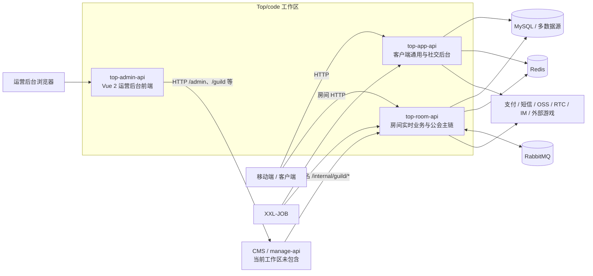

关键约束：

- 三个目录是独立代码库，不通过源码依赖互相耦合。
- `top-admin-api` 只包含浏览器前端；它依赖的 CMS 后端不在当前工作区。
- 浏览器不得直接调用 `top-room-api` 的 `/internal/guild/**`；该接口由 CMS 服务端签名调用。
- `top-app-api` 负责公共身份、社交及客户端通用能力；`top-room-api` 负责实时房间状态、房间授权、礼物处理及公会结算主链。

## 2. 模块职责

| 代码库 | 技术形态 | 主入口 | 核心职责 | 主要接缝 |
|---|---|---|---|---|
| `top-app-api` | Java 17、Spring Boot、Maven Reactor | `AppApiApplication`、`JobApplication` | 客户端通用接口、用户与社交、动态头像权益、支付、外部游戏、钱包兑换、公会工资扣减、后台任务 | HTTP、`IPayService`、`ISmsProvider`、`ZeeOneGameService`、`GuildSalaryRealtimeClient`、`DynamicAvatarExpiryService`、`JavaJob` |
| `top-room-api` | Java 17、Spring Boot 单体 | `RoomApiJavaApplication` | 房间状态、礼物队列、RTC/IM、公会月结与独立周结主链 | HTTP、RabbitMQ listener、XXL-JOB handler、内部公会接口、周结服务 |
| `top-admin-api` | Vue 2.7、Vuex 3、Vue Router 3、Element UI、Webpack 4 | `src/main.js` | 运营页面、菜单导航、后台接口调用、礼物/座驾媒体元数据维护 | Vue route、`src/api`、Axios 请求模块、CMS 菜单树、CMS/OSS 上传 |

## 3. top-app-api

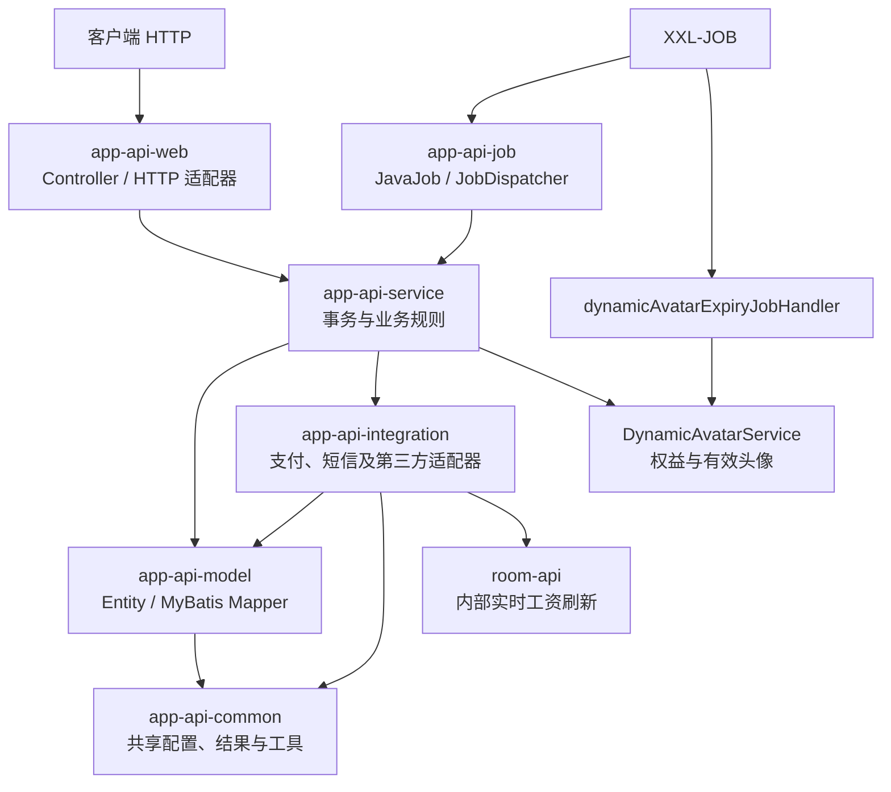

依赖方向为 `web/job -> service -> model/integration -> common`。Controller 只翻译 HTTP；事务和业务规则属于 service。支付与短信通过接口加工厂形成真实接缝，新增渠道应实现现有接口并注册到工厂。后台任务通过 `JavaJob` 与 `JobDispatcher` 分发。

外部游戏列表与房间准入由 `ExternalGameService` 统一，供应商类型 `1` 为百顺、`2` 为 ZeeOne。ZeeOne 的客户端入口 `/api/zeeone/session/generate` 基于已登录用户生成绑定应用、用户、游戏和房间的 Redis 会话；供应商通过免 App JWT 的 `/provider/zeeone/v1/api/**` 查询用户、变更余额和续期。`ZeeOneRequestVerifier` 负责原始正文签名、时间窗、来源 IP、应用 ID 与 nonce 防重；`ZeeOneGameService` 负责会话、订单锁、钱包事务、`ln_game_detail` 幂等凭证及扣款消费 outbox。余额回调校验会话绑定的游戏，房间归属直接采用会话值，不要求供应商回传 `room_id`。回调控制器以请求 ID 关联 INFO 级原始请求和实际响应，同时不记录内部异常消息或堆栈。ZeeOne 种子 SQL 重跑时刷新运营字段并保留已有非空图标，游戏启用状态由导入后的选择语句控制。

个人主页标签由 `HomepageLabelAssembler` 合并自定义标签、实时身份和 `ln_user.identity` 的后台身份。实时身份优先顺序为币商、公会长、主播，公会长兼主播时只显示公会长；后台身份代码 4-11 按 `UserIdentityEnum` 排序。发现页只按公开用户编号或当前有效靓号检索，不暴露内部 `user_id` 搜索；第三方支付币商查询使用同一类公开标识，有效用户返回完整头像 URL、当前有效靓号和国家编号，找不到或已封禁的用户返回 `showAgent=false`。房间访客列表由 `RoomVisitorMapper` 查询有效靓号，`RoomServiceImpl` 组装展示编号及头像框；与 room-api 的房间管理和排麦响应共享 `user_code`、`good_number`、`is_good_number`、`display_user_code` 字段语义。

公会钻石兑换由 `app-api-service` 的钱包 Saga 负责幂等扣减：月结成员更新月结薪资明细，周结成员更新当前周薪资明细；扣减成功后通过 `GuildSalaryRealtimeClient` 调用 room-api 的签名内部接口刷新实时工资。room-api 仍负责实时工资重算及后续结算主链，刷新失败不回滚已完成的钱包兑换。

动态头像由 `top-app-api` 维护权益和头像源数据：`ln_user_data` 保存静态头像、动态头像及 Unix 秒到期时间，`ln_user_dynamic_avatar_entitlement` 保存权益来源和累计到期记录。所有动态头像权益都属于展示状态，不覆盖用户已确认的 `head_picture` 持久化值；用户资料、排行榜等响应组装器只将 JPG/JPEG/PNG 视为可持久化静态头像，缺失时使用默认头像解析器。`dynamicAvatarExpiryJobHandler` 只在存在真实静态来源时同步持久化回退。`top-room-api` 读取同一用户数据契约，为房间、公会、结算和排行榜响应填充有效头像。消息、礼物推送和陪玩订单 payload 继续使用原头像字段，不自动扩展动态状态字段。

充值奖励可以通过 `grantDays` 为已有动态头像权益续期，保持原动态素材和权益来源幂等键不变。VIP 动态头像特权从 VIP5 开始；用户确认新静态头像时会清除当前动态素材。奖励通知格式化器对动态头像、VIP 等资产输出可读明细；字段不完整时保留明细行并显示本地化缺失标记，避免通知内容静默消失。通知正文以 HTML ` ` 分隔奖励行，靓号奖励另附本地化客服选择提示。

充值消费回填由 `RechargeConsumptionBackfillService` 维护批次、币商目标快照和消费来源。批次首次创建时持久化 Riyadh 时区窗口与启动截止点；重试只能复用该窗口。目标快照完成后保持冻结，不因当前币商集合变化而扩张；旧批次通过已保存的目标数与目标行兼容判定完成状态。消费账号类型按事件发生时是否已有有效币商身份固化；外部游戏和幸运礼物按 `0.1` 倍计入活动消费，普通消费按 `1.0` 倍计入。

定制礼物充值资格由 `CustomGiftRechargeGrantService` 扫描当月充值汇总，`CustomGiftXxlJob` 调用 `CustomGiftGrantClient` 向 room-api 的签名内部接口发放；App 不持有礼物或权益状态。App 的任务容器采用 `Asia/Riyadh` 系统时区，资格月份仍由业务代码显式按该时区计算。第三方币商与钱包日志、排行和关系列表逐步统一有效靓号、展示编号及 `special.avatar` 头像框字段；公开检索仍以公开编号和有效靓号为准。

充值奖励订单的档位来源同时兼容数值档位键与历史 `highest_tier` 语义键。历史键通过同用户、同周期内最高的有效档位成就解析，奖励订单和成就状态仍以持久化档位值关联。

充值排行榜查询按固定的金币、达成时间、财富等级和用户 ID 顺序分页；组装前必须过滤已删除或缺少用户资料的记录，避免其占用榜单名次或影响用户自身排名。分页查询不可用时回退到完整周期查询；档位重新达到时会复用并重新激活无效成就，奖励分组对外输出 `TOP1` 至 `TOP5`。无指定事件的扣除只选择当前 Riyadh 月内有效的充值与消费事件，按发生时间和事件 ID 确定顺序，影响结果同时返回扣除前后的最高有效档位。

已知热点是 `UserController` 与 `UserServiceImpl`。新增用户能力应落入资料、关系、账号安全或钱包等聚焦模块，避免继续扩大公共用户模块。

## 4. top-room-api

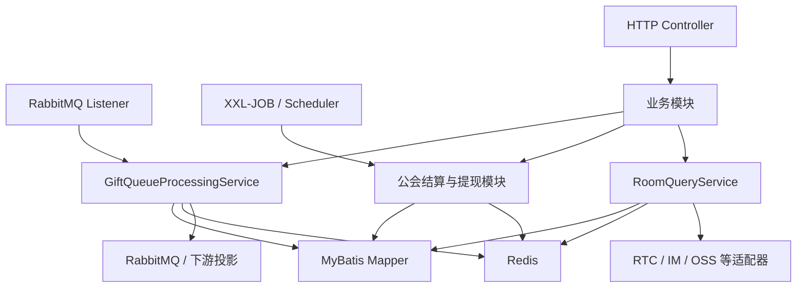

HTTP、消息监听器和定时任务是三个独立入口接缝。入口只负责传输解析与校验；幂等、重试、状态流转和事务属于业务模块。

关键深模块：

- `GiftQueueProcessingService`：礼物状态流转、幂等、失败重试和下游投影。
- `GuildMonthlySettlementTask`：实时薪资刷新、账单生成、账单确认的编排。
- `GuildWeeklySettlementTask`：独立自由政策周结的刷新与结算调度。
- `GuildWeeklySettlementService`：周收入刷新、薪资计算、账单生成/确认、登录用户周结查询，以及离会和资产调整后的周结刷新。
- `GuildSettlementPeriodService`：以 `Asia/Riyadh` 计算月结月份和周一周结起点，将既有 `Asia/Shanghai` DATETIME 转换为结算键及查询边界。
- `CustomGiftEntitlementService` / `CustomGiftGrantTransactionService`：定制礼物权益、提交、到期和发放事务；`UserAccountBalanceService` 统一金币扣减与同事务流水，`CustomGiftRankingService` 汇总已成功发送的礼物到 Redis 周榜。
- `GuildSystemNoticeService`：公会申请与管理员身份、月/周结完成、工资转账及提现状态的本地化通知。
- `GuildPolicySettlementResidueService`：政策从月结与周结之间切换时，负责收入汇总和实时工资残留迁移；源行加锁，目标行通过唯一键原子合并，资产调整金额随收入迁移，只有成功合并后才删除源行。
- `GuildSettlementQueryService`：公会结算查询与计算。
- `GuildWithdrawService`：提现、冻结、入账与失败恢复。
- `RoomQueryService`：房间状态与用户行为，复杂度较高，新增职责前应提取聚焦模块。

月结和周结使用不同的收入、工资明细和账单模型。周结支持当前周刷新及历史周补偿，主播账单确认后停止追加收入；周结政策目前不支持兑钻、资产调整和预支。当前周结主执行入口是 XXL-JOB，登录用户查询入口是 `/api/guild/weekly`；后台签名刷新、月/周结算汇总和政策转换补偿统一由 `controller/internal/GuildInternalController` 分流到月结服务、`GuildWeeklySettlementService` 或 `GuildPolicySettlementResidueService`，不再存在独立的周结内部控制器或批处理服务。

月结和周结确认都会发送本地化完成通知。主播通知展示周期和总薪资；公会长通知将管理收益与其本人主播薪资合并展示，阿拉伯语动态内容使用 LTR 隔离符。双身份公会长的当前工资响应同时提供月度管理收益、周度管理收益和总薪资余额。自由周结的固定分成为主播 73%、公会长 27%；周结成员离会时结转并锁定当周收入，再刷新周结实时工资，避免重复结算。

加入和退出公会申请同时通知公会长与有效管理员，并排除申请人和重复收件人；管理员权限实际变化时通知目标成员。普通礼物允许自送，扣款前锁定发送者钱包行，返回余额来自同一锁定快照。礼物积分以收礼金币为基数，普通礼物魅力值倍率为 `1.0`，幸运礼物保持 `0.1`，并继续受 `GIFT_SCORE_POLICY_EFFECTIVE_AT` 生效时间约束。

房间成员精确查询支持内部用户 ID、公开用户编号和当前有效靓号。房间管理用户搜索按公开编号或有效靓号精确匹配，列表和总数复用相同条件；管理列表和排麦响应用有效靓号优先的 `display_user_code` 展示编号，同时保留原始 `user_code`。管理员“请离”用户时会写入持久化房间黑名单并同步其 Redis 投影；原独立的 20 分钟临时踢出 key 和错误码已移除，解除限制统一通过移除房间黑名单完成。

政策转换补偿由 `top-admin-api` 的公会成员页面发起 `/guild/member/policy/conversion-compensation`，由 room-api 的内部公会控制器执行。公会工资和主播结算页面支持月结、周结两种查询周期；月度参数与周度参数必须互斥，并由 CMS 后端完成最终权限和业务校验。列表查询还可选择实时/快照视图、结算状态和地区并提交后端排序字段，页面兼容旧字段并展示主播、公会长及可提现汇总。

签名手动结算接口在 room-api 内分别调用月结服务和当前周结服务，并仅在响应层汇总刷新、生成、确认、入池及收入锁数量。月结与周结的数据模型和事务边界仍保持独立。

提现申请以 `source_pool_type` 明确选择单一余额池，校验、冻结和扣减都以该池为边界。个人薪资池沿用通用金币兑换配置，金币工资奖励池使用独立兑换率；首页可以汇总展示多池余额，但提交申请不会跨池自动补足。现金提现日期检查目前在 `GuildWithdrawService` 中暂时停用。提现转金币实际入账时，room-api 在钱包事务中同时写入 `withdrawal_to_coin:<orderNo>` outbox；app-api 将其消费为等额充值信用事件。已有钱包入账日志的重试直接复用结果，不重复产生 outbox，也不重复发送到账通知；转公会长及现金提现提交、通过、拒绝同样由 `GuildSystemNoticeService` 通知。

提现来源池契约允许金币提现使用个人薪资、金币奖励或主播转入余额，现金提现使用个人薪资或主播转入余额，转给公会长仅使用个人薪资；省略来源池时仍按历史优先级处理。政策快照按政策类型归一化固定分成比例，不采信请求中或成员记录中的可变比例作为最终结算规则。

礼物消费投影以持久化礼物记录为事件事实：钱包日志和充值消费 outbox 共享记录发生时间，并按每条记录的类型判断普通或幸运礼物。用于投影的内部时间和类型字段在返回客户端前移除。

充值活动扣除预览统一走公会资产审核接口 `/guild/asset/audit/preview`，前端确认弹窗展示候选用户、扣除金额、影响流水、来源场景和涉及周期；旧导出名只承担调用方迁移期间的兼容，不代表独立接口。

## 5. top-admin-api

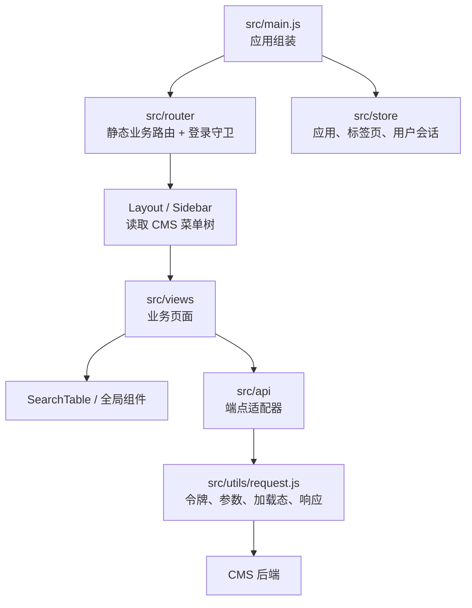

主依赖方向为 `view -> api adapter -> request -> CMS backend`。请求模块是当前最重要的外部接缝；业务调用者只应声明端点、方法和业务参数。

礼物和座驾音效上传沿用 CMS/OSS 媒体链路：前端表单通过现有上传适配器取得 MP3 地址，再以 `sound_url` 随业务对象提交给 CMS；预览和清除只改变表单及业务字段，不绕过统一请求模块直接访问存储。

公会工资和主播结算页面继续共用 `SearchTable`，并将地区、结算状态、实时/快照视图和后端排序字段作为查询参数交给 CMS；页面层负责兼容旧薪资字段并展示主播、公会长、金币和可提现汇总，不改变 CMS 的权限边界。周结筛选发送 `policy_type=3`，月结筛选省略该字段以同时覆盖 TG 与自由月结政策；`settlement_month` 与 `period_start` 保持互斥。游戏数据页按 `provider_type` 从 CMS 获取游戏选项，切换厂商时清除旧游戏选择；统计、明细和导出使用同一筛选条件。

认证与菜单现状：

1. 登录页面 dispatch `LoginByUsername`。
2. Vuex 用户模块保存 token、截止时间、用户信息和菜单树。
3. 路由守卫检查 token 与前端截止时间。
4. Sidebar 从本地存储读取菜单树并按 `menu_key` 导航。
5. 全部业务路由已静态注册，因此菜单隐藏不等于路由授权，后台接口必须再次鉴权。

结构热点：

- `src/utils/request.js` 已覆盖绝大多数请求，是应继续深化的统一模块。
- `src/utils/requestHall.js` 是携带嵌入凭据和不同响应语义的遗留适配器；不得新增调用者。
- `SearchTable` 封装筛选、表格、分页、排序和操作栏，具备较高杠杆，但接口已较宽。
- 当前业务页的操作插槽自行声明固定在右侧的 `el-table-column`，外层插槽不直接提供行数据，行级操作在内层 `slot-scope` 获取并做空值保护。
- `room/room.vue`、`member/listUsers.vue` 等旧页面超过千行；新功能优先采用 `wallet/assetOperation` 的页面、表单、卡片和弹窗拆分方式。
- 菜单来自 CMS 数据库，不由前端路由生成；新增入口必须同步 `menu_key` 及权限数据。

成员列表隐藏邀请码和邀请礼包列，展示身份代码 1-11；编辑资料时仅允许修改后台身份 4-11，并原样保留公会长、主播和币商等实时身份 1-3。充值活动金币扣除在进入预览前拒绝币商用户。

## 6. 关键跨系统流程

### 客户端请求分流

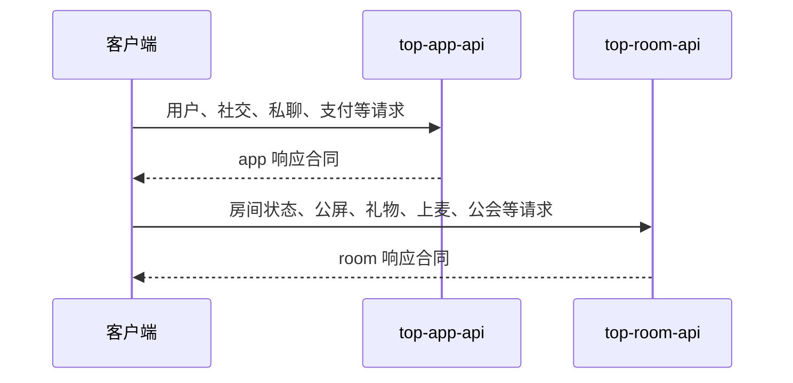

两个服务的成功响应字段存在历史差异，跨服务统一响应时应保持客户端兼容，不能只改单侧。

### 公会钻石兑换与实时工资刷新

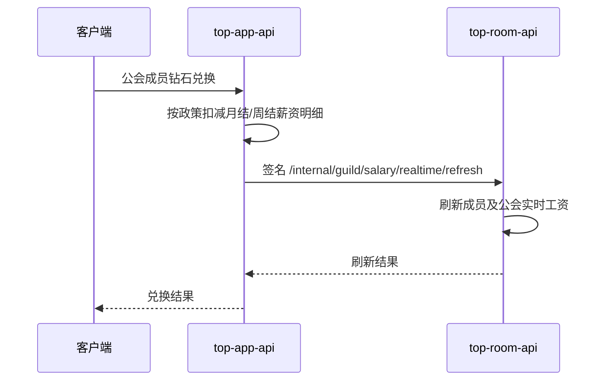

钱包兑换的资金扣减和实时工资刷新是两个阶段：前者由 app-api 事务保证幂等，后者由 room-api 执行并允许降级失败；不得把刷新失败误报为兑换失败。

### ZeeOne 外部游戏资金链

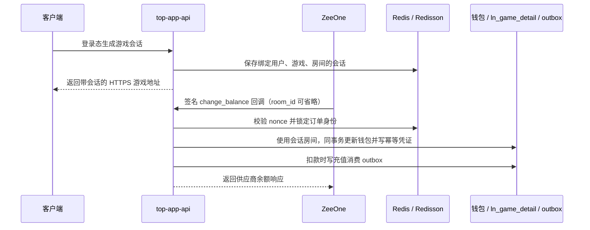

回调身份以服务端会话为准，不能只信任供应商传入的用户号。事件幂等键由应用、供应商订单和操作类型派生；相同事件只返回原余额，不同负载复用同一事件键必须拒绝。签名原文、会话令牌和密钥不进入通用访问日志。

### 动态头像有效性

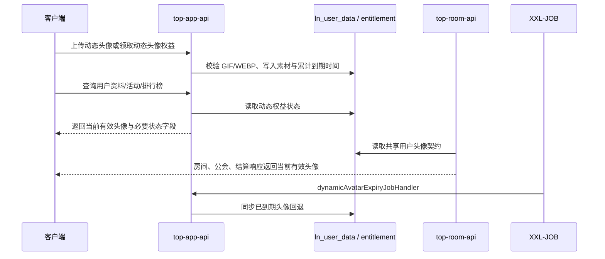

动态头像的数据库字段是 app-api 与 room-api 的共享数据契约，不构成源码依赖。查询接口必须按当前时间即时判断有效性，不能等待定时任务完成后才回退；任何动态权益的持久化更新都不得覆盖用户确认头像，无有效静态素材时由响应层返回默认头像。

### 公会独立周结

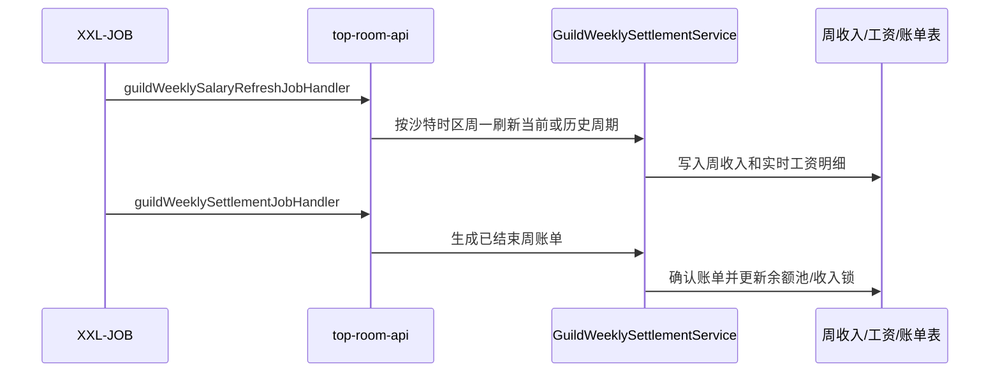

周结的刷新、生成和确认必须保持可重跑；已确认主播账单拒绝继续追加收入，确认失败时保留待确认状态供后续重试。

### 定制礼物资格与生命周期

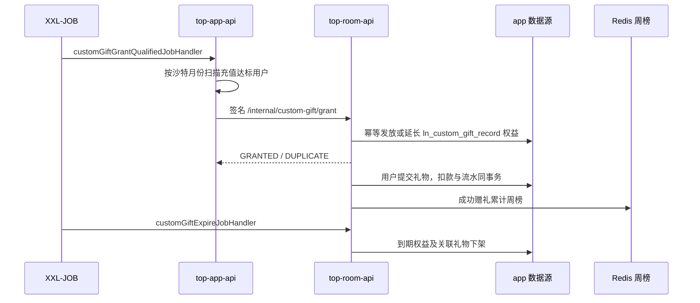

`/api/custom-gift/**` 由 Room 对客户端提供权益概览、提交和排行，`/internal/custom-gift/grant` 使用与既有内部接口相同的密钥及带时间戳签名。权益和礼物存储在 Room 的 `app` 数据源；`CustomGiftResponseAdvice` 仅将定制礼物路径包装为客户端兼容的 `code/message/data`。

### 公会后台操作

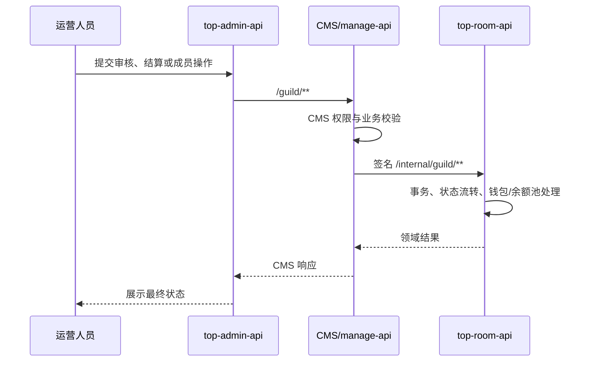

结算的“生成”和“确认”是两个独立操作。后台移除成员、提现确认、预支发放和实时薪资刷新必须经过 room-api 主链，不能用 CMS 直接更新状态替代。

## 7. 改动归属速查

| 改动类型 | 首选代码库/模块 | 联动检查 |
|---|---|---|
| 用户资料、社交关系、私聊、支付、短信 | `top-app-api` focused service | 客户端合同、数据库、第三方适配器 |
| 主页身份标签与币商用户检索 | `top-app-api` `HomepageLabelAssembler` / wallet service | `ln_user.identity` JSON、身份码 4-11、公开用户编号、有效靓号、图标本地化 |
| ZeeOne 外部游戏 | `top-app-api` `ExternalGameService` / `ZeeOneGameService` | 签名与 IP、Redis 会话/nonce、订单锁、钱包事务、`ln_game_detail`、消费 outbox |
| 动态头像上传、权益和到期回退 | `top-app-api` 动态头像模块 | `ln_user_data`、权益表、room 公共头像输出、XXL-JOB |
| 充值消费历史回填 | `top-app-api` recharge backfill | Riyadh 时间窗口、币商目标快照、幂等批次和迁移兼容 |
| 定制礼物资格与权益 | `top-app-api` 资格扫描；`top-room-api` 发放、礼物和榜单 | 签名内部调用、`ln_custom_gift_record`、金币流水、Redis 周榜、双端 XXL-JOB |
| 公会钻石兑换、月结/周结工资扣减 | `top-app-api` 钱包 Saga | 政策类型与结算周期、幂等回放、room-api 实时刷新 |
| 月/周政策转换残留与补偿 | `top-room-api` `GuildPolicySettlementResidueService` | 收入汇总、工资明细、资产调整、源行锁和幂等合并 |
| 礼物消费日志、积分与充值投影 | `top-room-api` `GiftQueryService` / `GiftScorePolicyService` | 持久化发生时间、普通/幸运倍率、wallet log 与 outbox 一致性 |
| 公会提现与金币兑换 | `top-room-api` `GuildWithdrawService` | 单一来源余额池、冻结/扣减一致性、按池兑换率、充值信用 outbox |
| 充值奖励与通知明细 | `top-app-api` recharge reward services/common formatter | 动态头像续期、幂等来源、资产本地化和缺失字段降级 |
| 资产扣除预览与确认 | `top-admin-api` asset operation | `/guild/asset/audit/preview`、请求 ID 生命周期、候选凭证确认 |
| 房间状态、上麦、房间权限、礼物、公屏 | `top-room-api` focused service | 持久化房间黑名单及缓存投影、Redis、RabbitMQ、RTC/IM、副作用幂等 |
| 公会实时工资、月结/周结、提现、预支 | `top-room-api` `GuildSettlementQueryService`、`GuildWeeklySettlementService`、`GuildWeeklySettlementTask`、`GuildWithdrawService` | CMS 调用合同、周一周期、任务重跑、通知和资金状态 |
| 充值排行榜、档位成就和扣除影响 | `top-app-api` recharge query/tier/deduction services | 删除用户过滤、确定性分页、无效成就复用、最高档位影响字段 |
| 后台页面、筛选、展示、菜单入口、礼物/座驾音效 | `top-admin-api` 对应 feature | CMS 接口、OSS 上传、菜单 SQL、按钮权限 |
| CMS `/guild/**` 业务接口 | 工作区外 `manage-api` | `top-admin-api` 调用方、room 内部签名接口 |
| 跨服务响应对象调整 | 对应 Java 服务 | app/room 历史响应差异、前端兼容 |

## 8. 验证入口

- `top-app-api`：对受影响模块执行 Maven 定向测试，并通过 `-am` 编译依赖模块；跨模块变更同时编译 `app-api-web` 或 `app-api-job`。
- `top-room-api`：执行聚焦测试；礼物队列覆盖重复投递和失败重试，公会月结和周结分别覆盖周期/公会定位、重跑、部分失败、待确认到确认、余额池写入、收入锁、策略变更延迟补偿和本地化结算通知。
- `top-admin-api`：执行适用的 `scripts/` 检查，再执行 `yarn build:dev`；生产构建相关改动执行 `yarn build`。公会工资/主播结算改动还要核对月周周期参数和政策转换补偿接口。部分钱包检查依赖工作区外的 `manage-api`，缺失时应明确报告。

