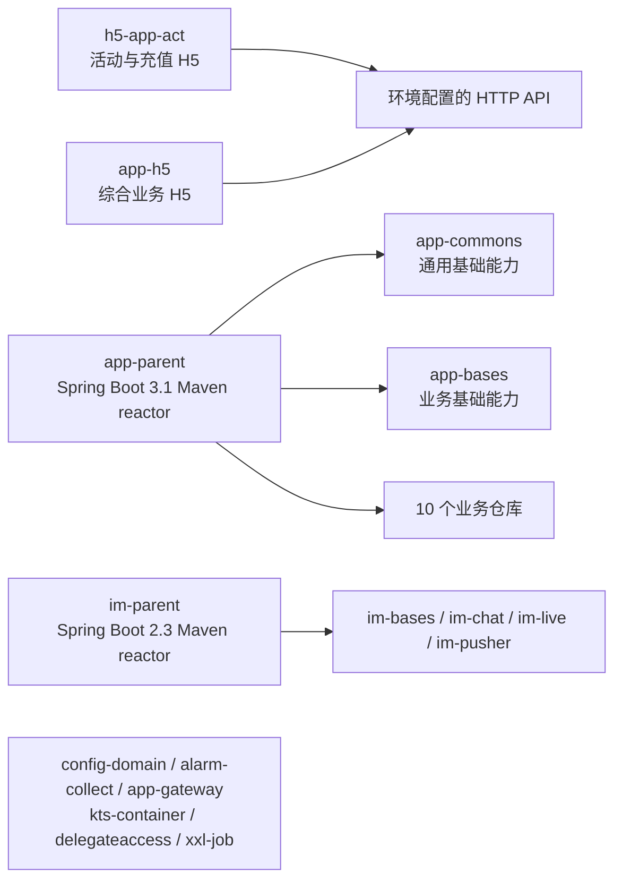

# Wechill 代码架构地图

本目录有 26 个独立 Git 仓库：两组跨仓 Maven reactor、两个 H5 前端，以及六个独立服务或工具。此图记录已由 POM、路由、README 和源码入口确认的结构；具体部署地址和跨服务调用仍以各环境配置及接口实现为准。

## 工作区结构

图中的 H5 到 API 表示各自配置的 HTTP 请求边界，**不代表已确认其请求由某个同名仓库承接**。`app-parent` 与 `im-parent` 是两个不同的聚合工程，不能互换父 POM；其跨仓模块路径均以同级目录为前提。

## App Reactor

`app-parent/pom.xml` 引用下面 12 个同级仓库，基于 Spring Boot 3.1.11。业务仓库通常按 `data`、`client`、`service` 拆分：数据对象与 SQL 位于所属仓库，跨模块契约由 `client` 承载，业务执行位于 `service`。具体模块以各仓库 POM 为准。

| 仓库 | 主要职责或模块 |
|---|---|
| `app-parent` | 聚合构建与依赖版本 |
| `app-commons` | 通用组件；含 Redis、SQS、S3、DynamoDB、搜索、Apollo、XXL-JOB 等适配模块 |
| `app-bases` | 业务基础模型、服务、Web/Feign、鉴权与基础设施适配 |
| `admin-content` | 内容管理、BD 组织与薪资规则；`content-data`、`content-client`、`content-service` |
| `app-user` | 用户、登录、注册、认证；`user-data`、`user-client`、`user-service` |
| `app-chat` | 聊天业务；`chat-data`、`chat-client`、`chat-service` |
| `app-live` | 直播业务；`live-data`、`live-client`、`live-service` |
| `app-home` | 主页业务；`home-data`、`home-client`、`home-service` |
| `app-payer` | 支付业务；`payer-data`、`payer-client`、`payer-service` |
| `app-game` | 游戏业务；`game-data`、`game-client`、`game-service` |
| `app-act` | 活动业务；`act-data`、`act-client`、`act-service` |
| `app-state` | 状态业务；`state-data`、`state-client`、`state-service` |
| `app-pusher` | 推送业务；`pusher-data`、`pusher-client`、`pusher-service` |

`app-user` 的 README 将用户写业务归属登录、注册、认证等，并要求核心服务避免依赖边缘服务接口。跨仓调整应从拥有业务规则的服务开始，检查其 `client` 合同与调用方；不要仅凭仓库名称假定运行时调用链。

`env/test` 中，BD 组织树、员工资格、政策版本和团队薪资计算位于 `admin-content/content-service`；持久化模型与跨服务契约分别位于同仓库的 `content-data`、`content-client`。`app-user` 的 BD/BDM 接口调用该契约。旧组织模型通过 BDM 本人自挂，按本人及直属下属计算团队；新组织模型按本人及全部有效后代计算；实时薪资快照带组织和政策版本，查询时校验有效性。

## IM Reactor

`im-parent/pom.xml` 引用四个同级仓库，基于 Spring Boot 2.3.2.RELEASE；IM 服务 README 指向 SmartFox 通信场景。

| 仓库 | 主要职责或模块 |
|---|---|
| `im-parent` | IM 聚合构建与依赖版本 |
| `im-bases` | `bases-model`、`bases-feign`、`bases-server` |
| `im-chat` | 客户端消息收发和需记录的聊天消息；`chat-client`、`chat-service` |
| `im-live` | 直播 IM 服务；`live-client`、`live-service` |
| `im-pusher` | 客户端状态同步和推送；`pusher-client`、`pusher-service` |

## H5 与独立项目

| 仓库 | 技术与入口 |
|---|---|
| `h5-app-act` | React 17/Umi 3；`config/routes.ts` 定义登录、活动、第三方充值及支付结果路由，`src/app.ts` 统一处理请求签名、加密、会话和 App bridge，`src/services` 封装接口 |
| `app-h5` | React 17/Umi 3；`config/routes.ts` 定义公会等业务页面，按 `package.json` 的环境与 `APP_TYPE` 脚本构建 |
| `config-domain` | Kotlin/Quarkus/Gradle；域名配置、Apollo 配置与定时检查，入口位于 `src/main/kotlin` |
| `alarm-collect` | Kotlin/Quarkus/Gradle；错误收集及告警通知策略 |
| `app-gateway` | 独立 Maven 网关工程 |
| `kts-container` | Kotlin/Spring Boot 脚本容器，入口 `KtsContainerApplication` |
| `delegateaccess` | Kotlin/Spring Boot 委托访问服务，入口 `DelegateAccessApplication` |
| `xxl-job` | Maven 工程，包含 `xxl-job-core` 和 `xxl-job-admin` |

`h5-app-act` 与 `app-h5` 各自维护环境 API 配置。修改前端请求或服务端响应时，应按具体接口核对两端合同，而不是按目录名称建立默认对应关系。

## 验证路径

- App 或 IM 聚合工程：在对应父 POM 下验证受影响模块，确保同级仓库齐全；持久化变更同时检查所属仓库的 SQL 与测试。
- H5：运行目标环境的 `package.json` 构建脚本，检查路由、请求处理与嵌入 App 的交互。
- Gradle 项目：使用仓库内的 `gradlew` 或 `gradlew.bat`；其他 Maven 项目按自身模块和启动入口验证。
